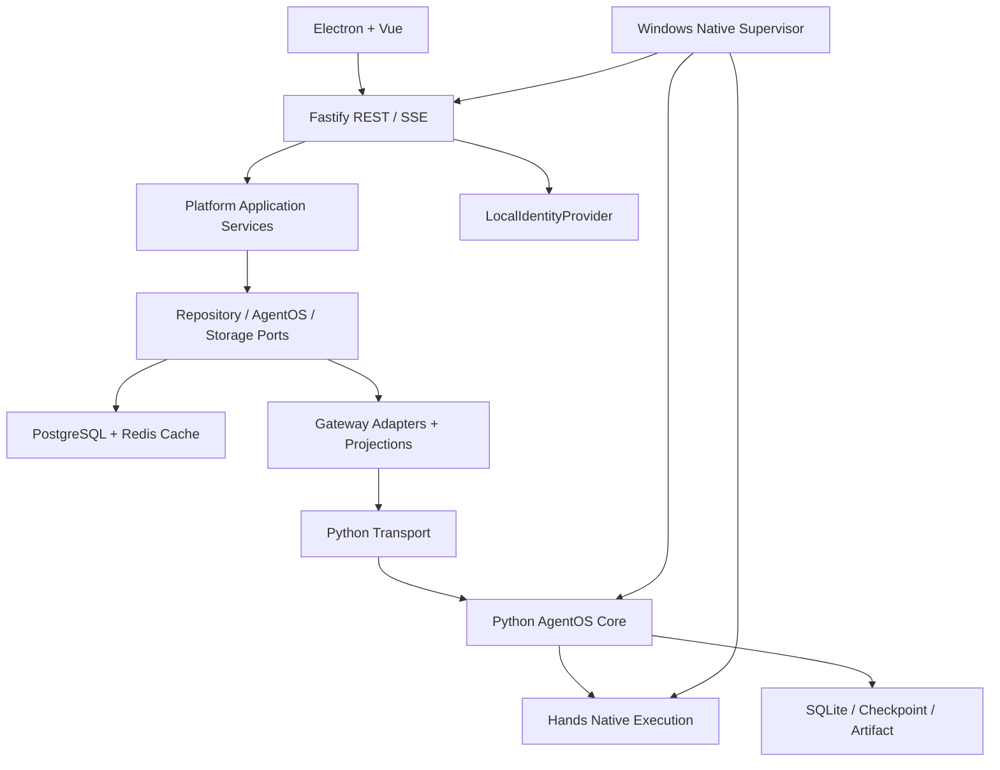

# PR-TS-00-TypeScript目标架构设计

> 基线：`8775130f22b0440398c876a99206a47054e0b30c`，master；审计日期：2026-11-07（Asia/Shanghai）。本轮只生成审计材料，未实施迁移。
>
> VERIFIED = 本轮源码/命令证据；INFERRED = 基于源码的分析或目标设计；UNKNOWN = 证据不足；BLOCKED = 本轮无法安全检查。静态路由存在不等于运行成功；测试声明数不等于测试通过数。

## 设计状态

INFERRED / PROPOSED：面向PR-TS-01的正式架构草案，未创建TypeScript后端、未安装依赖、未改业务源码。PR-TS-01须先通过风险报告准入门禁。范围仅Java平台重写；Python Core/ACG/Hands继续是原权威。



## 候选技术评估

| 技术 | 项目中的用途/依据 | 结论与准入验证 |
| --- | --- | --- |
| Node.js 24 | 本机v24.19.0已存在，Hands engines>=24.9.0；目标需要Windows native streams/abort | 采用24系列，后续锁定patch/包hash；不依赖开发机全局PATH的产品运行时 |
| TypeScript | 现有Hands/Electron为TS，前端5.4.5而其他5.9.3 | 新包独立锁版本/strict；不连带升级前端或Hands |
| Fastify 5 | REST插件边界、schema、Pino、可测试inject；适合薄平台网关 | 推荐；需验证wildcard优先级、multipart/SSE、Windows close；不靠框架自动复制Spring安全 |
| Zod | trusted input/config/上游wire验证与闭合DTO | 推荐；Fastify默认JSON Schema与Zod的桥接需明确；不声称可直接塞Zod对象作为默认schema |
| pg + Kysely | 保留现有SQL/JSONB/partial unique/事务；不用JPA懒加载 | 推荐；types不是runtime schema，pg UUID/time/count/JSONB映射需单测和真实PG验收 |
| Redis client | roles缓存 + 现有Python协调继续保留 | 客户端候选需小型连接/重试/关闭验证；TS只负责自己的缓存，不改Lua lease协议 |
| Pino | requestId、结构化日志、redaction | 推荐，密钥/正文/完整路径默认不记录；trace和低基数metric独立于日志 |
| Vitest | 已有TS测试惯例；adapter/mapping单元与HTTP合同 | 推荐；注入测试之外必须真实socket SSE、PG15、Redis和Windows supervisor验收 |
| Node Stream / AbortController | 背压、上游取消、idle/max deadline | 推荐；不同超时reason必须区分，避免把timeout全算用户取消 |

本轮通过Context7核对官方Fastify与Kysely文档：Fastify5默认校验需要完整JSON Schema，close生命周期需明确释放资源；Kysely提供pg Pool方言与托管事务callback提交/异常回滚。这是文档能力证据，**不是本项目兼容性实测**。来源：[Fastify v5迁移指南](https://github.com/fastify/fastify/blob/main/docs/Guides/Migration-Guide-V5.md)、[Fastify Server](https://github.com/fastify/fastify/blob/main/docs/Reference/Server.md)、[Kysely事务实现](https://github.com/kysely-org/kysely/blob/master/src/kysely.ts)、[Kysely PostgresDialect](https://github.com/kysely-org/kysely/blob/master/src/dialect/postgres/postgres-dialect.ts)。依赖版本锁定、第三方插件兼容与许可证验证留在获准的PR-TS-01，不在本轮安装。

## 目录树（文档设计，不创建）

```text
apps/backend-ts/
  package.json / tsconfig.json / vitest.config.ts
  src/
    main.ts                         # 启动/停止，只有装配
    bootstrap/{container,server,lifecycle}.ts
    config/{schema,load}.ts
    domain/{identity,conversation,role,errors}/
    application/
      ports/{repositories,agentos,ai,storage,clock,identity,telemetry}.ts
      chat/{send-message,prepare-stream,record-stream-result}.ts
      conversations/{list,detail,rename,delete}.ts
      roles/{query,create,update,delete}.ts
      profile/ / search/ / recommendation/
    api/
      plugins/{request-context,local-access,trace,rate-limit,errors}.ts
      routes/{health,chat,conversations,roles,profile,files}.ts
      routes/agentos/{missions,runs,reviews,artifacts,observations,workspaces,events}.ts
      routes/ai-proxy.ts
      schemas/                      # 请求/响应wire schema，版本化
    adapters/
      identity/local-identity-provider.ts
      postgres/{pool,types,transaction,repositories}/
      redis/{client,role-cache}.ts
      storage/local-upload-store.ts
      python/{transport,paths,trusted-context,error-classifier}.ts
      agentos/{gateway,sse,projection-mappers}/
      platform-ai/{chat,rag,knowledge-graph,role-fusion}/
    projections/{mission,run,workspace,artifact,trace,provenance,chat}/
    observability/{logger,metrics,redaction}.ts
  test/{unit,contract,integration,sse,architecture,windows-native}/
  migrations/                       # 后续独立schema PR才允许新增SQL
  dist/main.js                      # 构建产物，产品入口
```

## 模块依赖方向与职责

1. REST routes只解析/验证、取服务端ActorContext、调用application、serialize DTO/status；不得直接import pg、拼Python URL或执行任务。
2. Application只依赖domain和ports；控制短事务/缓存失效/业务fallback，不能import Fastify、pg、Python运行内部实现。
3. Gateway adapter实现AgentOsPort；构造编码路径、传输、闭合projection、上游错误；无计划/调度/Permit决策。可以直接作为查询/命令薄application的实现，不额外复制空壳service。
4. PythonTransport是唯一出站owner：固定base origin、service auth、server trusted identity、trace、deadline、取消、byte/JSON/SSE边界和metrics。health可无actor，业务必须有actor；不能提供任意URL转发入口。
5. Repository负责SQL、owner过滤、显式事务连接与DB row映射；projection负责公开wire，不返回数据库row/entity给renderer。Domain纯类型/规则不依赖adapter。
6. LocalIdentityProvider只消费受信Home映射，提供稳定actor和wire tenant；Controller不读请求userId作为权威。bootstrap唯一允许同时import所有adapter与application的composition root。
7. SSE gateway只做流合同；StreamRecorder负责chat持久化，RuntimeEvent仍由Python产生。Storage port只处理平台uploads，不接管Python ArtifactStore/Checkpoint。

依赖Architecture Guard：application→api/adapters、domain→framework、route→SQL、非transport→外部HTTP、platform→Python runtime internals 均禁止；无JWT/session/密码模块；共享contracts只共享wire，不共享运行权威。

## REST / DTO / Error兼容策略

逐行实现route-inventory.csv的需要保留项，保留/api规范化和原生/api族；原有登录接口/改密码最终明确返回410或移除404并同步消费端，不为它们保留伪token。缺口五项不能凭空按前端类型实现业务：先与Python合同对齐/批准退役。

AgentOS command支持409对账、typed错误、binary与multipart；query投影保持白名单字段、枚举/nullable、UUID/time/count。迁移时冻结输入/输出匿名fixture，Fastify/Zod默认未知字段处理须与当前合同逐项核对，不能将校验加严自动当兼容修复。错误转换保留现有族差异，统一日志但不一刀切改变status/code/envelope。

## Database Repository / 事务 / 迁移权威

同步Chat保持“事务A：owner会话+user消息 → 提交 → HTTP → 事务B：assistant消息”，SSE同样不跨流占用PG事务。conversation删除先message再conversation在一个事务；roles更新commit后精确逐出缓存；repository必须接受非空ActorContext。stream attempt幂等需要独立schema与失败恢复设计，不能仅复制内存persisted布尔后宣称exactly-once。

V1–V13冻结不改写。TS初始仅校验真实Flyway状态及schema fingerprint，启动时不自动baseline/repair。正式不再依赖JVM后，以后续独立PR引入唯一TS migration runner：先对照历史Flyway checksum/成功状态完成一次有版本交接，旧Flyway history保留只读，新版本ledger记录来源baseline和SQL hash，在PG advisory lock下单写；严禁Java Flyway与TS runner并行变更schema。不能把SHA-256误当Flyway原checksum算法。交接、失败事务、旧版本拒绝启动与回滚都需PG15测试。

Redis roles旧值包含Java default typing元数据，TS使用新版本namespace，不全库FLUSH，不触碰DB1协调key；miss/断连仍回PG，更新删除失效有测试。TTL1h是当前合同候选，变更需单独批准；缓存不保存LocalIdentity或Grant权威。

## 无登录安全与LocalIdentity

无用户JWT/session，但保留服务认证、路径/IPC sender/执行批准。绑定loopback，严格校验Host和允许Origin（发行kinlin-app://shell、开发固定Vite origin）；不能只配置CORS后就放行跨站写。mutation要求JSON或受控multipart、自定义非简单请求header与服务端Origin检查，拒绝null/未知Origin；无Origin的外部请求只开放最小health，若需Main/CLI操作则设计受控本地桥接/独立进程服务认证，不将其伪装用户session。确切本机准入合同须在PR-TS-01前冻结并做真实socket测试。

renderer传入userId/tenantId/trusted headers一律忽略或拒绝；当前actor外owner的URL返回明确拒绝，不用“单机”理由绕过查询约束。Main IPC保留sender id+mainFrame+参数校验；terminal/Hands内部凭据保持独立，不因名字叫token误删。相同Windows用户下恶意进程不是靠ActorId解决的边界，发行设计只承诺受限Home ACL与应用入口校验，不虚称OS沙箱。

## SSE / Configuration / Logging / Native接入

SSE专门的parse/forward预算、UTF-8分片、多行data、heartbeat、idle/total时钟和Abort reason；新事件不得重排/伪造；Runtime cancel通过Python命令而非断流隐式执行。配置启动即验证required DB/service auth/Home identity，并支持原环境迁移映射；日志默认屏蔽Authorization、内部令牌、HMAC、API密钥、密码、请求正文和完整workspace路径，TraceId长度/格式验证，metrics禁高基数run/user标签。

Supervisor保持Node24服务描述符、18080默认端口/整体offset、健康别名、PID+creation-time身份、启动锁、失败回收、受限env与冷备清单；开发和发行共用描述符合同、显式profile策略，产品绝不接管陌生进程。shutdown由受控本机协议触发drain，不依赖Windows一定传POSIX信号；Chat drain与Python关闭次序需验收。发行包Node运行时是必需组件；无JVM/Hyper-V不等于无运行时。

## PR-TS-01应交付的可审结果

正式验收PR-TS-00后才可建立骨架、锁定依赖、冻结Actor/准入/错误schema、空health和Supervisor adapter、Architecture Guard与合同fixture；不得同时迁移所有CRUD、改变Python runtime或自动升级真库。真正业务切换需后续PR、备份和等价测试门禁。当前结论仍为NO-GO，不能因本设计明确而跳过数据库/身份补证。
