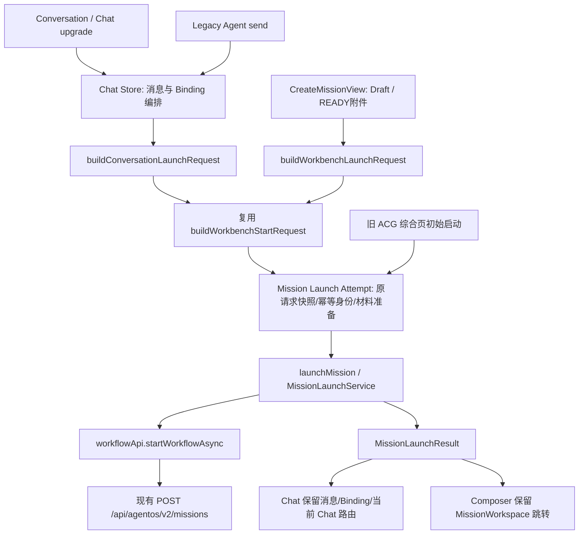
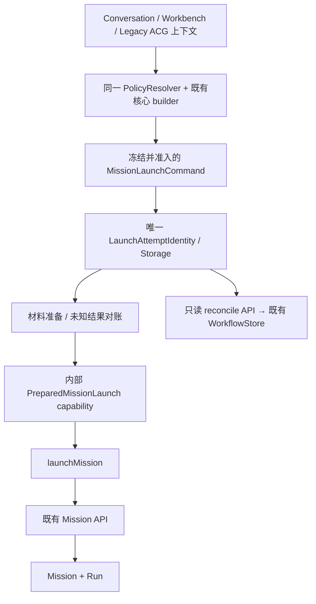

# PR-UI-01 统一 Mission Launcher：实施与启动安全收敛合并记录

> **文档性质**：阶段证据合并稿——实施记录 1 篇 + 同阶段安全收敛（R1）1 篇
>
> **覆盖时间**：2026-10-31
>
> **当前定位**：三入口启动合同统一与 409 冲突对账的原始记录；两篇均 SELF-TESTED，等待独立验收
>
> **合并日期**：2026-11-03

## 0. 合并说明与导读

本册把 **PR-UI-01（2026-10-31）** 的 2 篇记录合并为一篇：统一 Mission Launcher 实施记录、R1 Mission Launch Safety & Policy Convergence。正文逐字保留原文，仅做两类机械处理：标题层级下移一级、指向已合并/已归档文档的相对链接改写（经查本册原文均无站内相对链接，未发生改写）。来源清单见文末附录。

### 0.1 这一阶段在解决什么

UI-00 架构审计（见 [PR-UI-00](PR-UI-00-前端生命周期工作台架构审计-2026-10-31.md)）指出 Chat、Workbench 与创建页三个入口各自构造启动请求、各自处理 409 冲突，没有统一的操作身份。本阶段做两件事：

- **UI-01 实施**：把三个入口收敛到 `apps/frontend/src/features/mission/` 单一请求构造与启动编排（canonicalLaunchJson / missionCommandFingerprint / LaunchAttempt 身份），旧函数保留兼容包装；
- **R1 收敛**：在同一阶段内补启动安全与策略——conversationLaunchIdentity 持久 Binding、409 冲突机器分类、只读对账 API（Python `agentos_v2.py` + Java 网关白名单路由）、默认策略唯一入口 `resolveMissionLaunchPolicy`。

### 0.2 一页结论

| 篇目 | 性质 | 结论 | 关键证据 |
|---|---|---|---|
| UI-01 实施 | 实施记录 | SELF-TESTED：三入口统一到单一适配器，没有保留两套请求构造业务 | 定向与组件测试、vue-tsc、build:web 通过；HEAD `a51fb993`；无独立 ACCEPT |
| UI-01-R1 | 审计与实施 | SELF-TESTED：幂等对账与持久 Binding 落地，冲突显式重发起 | 新增 mission/ 六模块 + reconcile API（Python/Java）；HEAD 保持 `58fb2c7f` |

### 0.3 贯穿全阶段的不变量

- 请求构造只有一条正式路径（`features/mission/`），source 条件只负责兼容字段，Store 不再分支发送请求；旧函数未删除，只做兼容包装。
- LaunchAttempt 身份（operationId / clientRequestId / fingerprint）是操作一致性权威；409 必须走显式对账或重新发起，不静默 fallback。
- 启动策略默认值只从 `resolveMissionLaunchPolicy` 解析；后端只加只读对账端点与 409 稳定 header，不改持久化模型。

### 0.4 明确未完成与放行条件

- 两篇均为 SELF-TESTED，无独立 ACCEPT、真实后端/模型 E2E 或部署；R1 登记 sessionStorage 恢复边界与 6 条剩余边界（见原文第 10 节）。
- 升级后旧 session identity 若从未保存完整请求快照，首次重试可能因新正式语义 payload 指纹不同收到 409；按冲突流程显式重发起，不猜测成功。
- UI-01 实施 7 条剩余技术债见原文第 11 节（重试缓存寿命、Material 幂等 receipt、逐 Run selectedModel 路由等）。

### 0.5 阅读建议

先读 UI-01 实施记录的统一适配器与请求构造，再读 R1 的身份、冲突分类与对账合同。只想确认「三入口是否已统一、409 怎么处理」，看两篇各自的合同清单与剩余技术债清单即可。

## 篇目与阅读顺序

1. **PR-UI-01｜统一 Mission Launcher 实施记录** — 实施记录，2026-10-31 — 原文件 `PR-UI-01-统一MissionLauncher实施记录-2026-10-31.md`
2. **PR-UI-01-R1｜Mission Launch Safety & Policy Convergence** — 同阶段审计与实施，2026-10-31 — 原文件 `PR-UI-01-R1-Mission-Launch-Safety-Policy-Convergence.md`

---

## 1. 原文｜PR-UI-01｜统一 Mission Launcher 实施记录

<!-- 原始记录：PR-UI-01-统一MissionLauncher实施记录-2026-10-31.md -->

日期：2026-10-31（Asia/Shanghai）

状态：**SELF-TESTED**。本轮未进行独立 ACCEPT、真实后端执行验收或部署。

### 1. 基线、范围与现场保护

开始时已执行 `git status --short`、`git branch --show-current`、`git rev-parse HEAD`：

```text
branch: master
HEAD: a51fb993a71e43fe374c1885d3dad30eea8f21a7
预期审计基线: 7339d25fe6375bee50e54c374a206d5c4d23a8e1
 M apps/frontend/src/components/ModelRuntimeControls.vue
?? docs/开发记录/PR-UI-00-前端生命周期工作台架构审计-2026-10-31.md
```

预期基线至当前 HEAD 有四条发行相关提交：`2610d1e8`、`7dd15992`、`309f9f8b`、`a51fb993`。本轮在当前现场实施，未切换、重置或改写历史。检索未发现适用 AGENTS.md。上述两个已有文件保持原字节内容，核验 SHA256：

| 已有文件 | SHA256 |
|---|---|
| ModelRuntimeControls.vue | `7548EA9489E46C2C1C96F42D38200FCE235D44B3F3F01978A19BAB73A6FEE934` |
| PR-UI-00 审计报告 | `C25EF8E3DBED0DAC4E36EE3B1F521E11BB61C86EC3BF4BD991C1124FE6B0EE16` |

范围仅为“创建新 Mission + 启动初始 Run”的前端请求构造、调用、幂等与响应处理。未修改后端、API wire 类型、数据库、Planner/TaskPlan/ACG、Scheduler、Workspace Projection、Run Copilot、Retry/Resume/Review 合同、路由结构、package.json 或配置文件。没有删除页面、WorkspaceMode 或历史存储；没有提交、Push、Merge、部署。

### 2. 改造前后的真实调用链

改造前：

```text
ChatView(Chat upgrade / Agent send)
  → chat.startConversationWorkflow：自行构造分支 payload
  → workflowApi.startWorkflowAsync

CreateMissionView.submit
  → buildWorkbenchStartRequest + material 创建 + creationRetry
  → workflowApi.startWorkflowAsync

旧 AcgVisualizationView.startRun
  → builder + material 创建 → workflowApi.startWorkflowAsync
```

改造后：



Legacy Agent 和 Chat 的区别保留为历史来源、兼容标题/文本别名；任务核心语义、快照处理、Material 准备、正式 API 调用、响应校验不再各有实现。

普通消息仍是 `ChatView.sendMessage → chatStore.sendMessageStream`。rerun 仍调用 `rerunWorkflowAsync`，单节点 retry 仍调用 `retryWorkflowStepAsync`，审核/恢复仍由既有正式 API 处理，均不进入新 Mission Launcher。

### 3. 新增 feature 与合同

目录：`apps/frontend/src/features/mission/`。

| 文件 | 职责 |
|---|---|
| request.ts | Conversation/Workbench 输入上下文适配；统一复用现有 Workbench builder |
| launch.ts | 无 Vue、无 Router 的唯一初始启动调用权威；传递 signal、校验身份、返回结果 |
| launchAttempt.ts | 单次提交请求快照、显式重试、重复点击合并、Material 引用缓存 |
| conversationLaunchIdentity.ts | 从 ChatView 迁出的现有 sessionStorage 请求身份策略 |
| 同名四个 spec.ts | 请求、服务、幂等、旧存储兼容的独立测试 |

API wire contract 继续是 **AsyncWorkflowStartRequest**，没有另复制 MissionLaunchRequest 或修改它的定义。新增 ConversationLaunchContext / LaunchMaterials 仅是前端适配输入；WorkbenchDraft / PluginUiExtension / buildWorkbenchStartRequest 的原公开 API 保持不变。

架构结论补充：本轮统一的是核心 builder 的复用、提交快照/材料处理、启动 API 调用与结果校验，并不表示所有启动策略已经完全收敛。Conversation adapter 仍覆盖历史 domain/intent/reviewMode/scope；Chat 按显式 operation ID、Workbench 按 Draft signature 识别重试。launchMission 接收已构造的 wire request，尚无结构性约束强制未来调用方经过统一 builder/attempt。现有调用链已收敛，不等于未来无法绕过；测试通过也不能证明所有策略权威已消除。

```typescript
interface MissionLaunchOptions { signal?: AbortSignal }
interface MissionLaunchResult {
  missionId: string
  runId: string
  run: WorkflowRun
  clientRequestId: string
}
```

`launchMission(request, options?)` 每次只发一次异步启动；不自动重试，不同步 fallback，不路由跳转。不接受缺失、非字符串或空白 missionId/runId 的响应，抛既有 WorkflowApiContractError；HTTP 409/503 和底层 Contract Error 原样传播，不伪造 ID。

ChatWorkflowStartResult 保留 `response`、`binding` 供现有 View 使用，并增加 `launch: MissionLaunchResult`；`response` 即 `launch.run`。Composer 使用同一 Result 的 missionId/runId 进行现有跳转，旧综合页使用 `.run` 承接既有展示。

### 4. 请求字段对照

| 字段 | Conversation / Legacy Agent | Workbench Composer |
|---|---|---|
| title | 保留 Chat/Agent 历史标题；可显式指定 | Draft title / 现有自动标题 |
| semantics.objective | 两入口均为用户目标 | Draft taskGoal |
| semantics.constraints | 当前对话启动无结构化约束控件，默认空数组，不擅自抽取聊天文字 | 既有 constraint IDs/text/sourceRefs |
| semantics.sourceRefs | 适配器支持显式引用，默认空 | 默认空，支持外部 context.sourceRefs |
| domain / intent / workflowId | 保留调用选项；View 仍传 general/general；旧 Store 默认值兼容保留 | 既有 Plugin Extension contribution |
| reviewMode | 保留选项；View auto；旧 Store 回退 human_in_loop | Draft / 既有插件合法贡献 |
| input.source | chat / agent 保留 | acg 保留 |
| userIntent / taskGoal | 两入口现在均提供核心目标别名 | 保留现有 builder / 插件逻辑 |
| caseText / chatText | Chat 兼容字段保留 | 不额外制造旧 Chat 字段 |
| conversationId | 显式保存本次工作会话身份 | 无则不制造 |
| chatContextId / chatRoleId | 单独保存 Chat Store 的服务端上下文/角色，可为空 | 不制造 |
| chatContext | 最近八条消息，延续先截取再过滤非空、只传 role/content 的策略 | 不制造 |
| thinkingMode / reasoningEffort | View 传当前模型设置中的执行选项；重试冻结 | 现有 Draft/模型设置映射保持 |
| Web Search | 适配器可携带明确选择；普通 Chat 原有设置流程保留 | Draft 隐私选择最终覆盖插件或额外 input |
| planning mode/diversity/seed/capability | 复用 native builder 的默认配置 | 全量保留 dynamic/template_preferred、diversity、seed、capability |
| expectedArtifacts / materialIds / pluginData | 复用 native Draft 的默认值 | 原数组/深拷贝插件数据保留 |
| enabledPluginIds | 显式传递时保留；原有 omitted-scope 行为保留 | Draft 的显式 scope；插件不能改写 |
| attachmentIds / materialRefs | 适配器可接收，当前 Chat 文件 URL 不会被假冒为正式附件 | READY attachment IDs + 已有材料引用 + inline material 准备结果 |
| clientRequestId | sessionStorage identity + 原请求快照 | Draft signature + 原请求快照 |
| debugTrace / lowEntropyOptions | 不擅自启用 UI 中未提供的诊断选项 | 现有开关保持 |

模型配置边界：没有把 apiKey、baseUrl、providerConnections 放入 Mission 请求或重试缓存；普通聊天的模型选择、连接和发送路径未改。现有初始 Run builder 没有逐 Run selectedModel 路由合同，本轮不声称改变服务端模型路由，只承接已有 thinking/effort 执行选项。Conversation 与 chatContext 的两个 ID 没有互相覆盖。

### 5. source 与后端字段语义调查

本轮只读追踪了 `apps/agentOS/src` 与 `apps/agent/app`。

| 字段/组 | 当前真实使用与代码证据 | 本轮决策 |
|---|---|---|
| input.source | `support/stores/_policy.py:139,169-172` 任务/Run 列表按 source/sources 过滤；sqlite/memory workflow store 形成 overview；`agentos_v2.py:604` 对外投影 | 保留 agent/chat/acg，不归一为一个值；历史筛选继续有效 |
| userIntent/taskGoal | `runtime/workflow_runtime.py:1651` 选择规划目标；`components/mission_manager/semantic_resolver.py:41` legacy objective 别名选择；有正式 basis 时以 basis objective 为准 | 给三个入口完整核心语义，保留兼容别名 |
| constraints | `runtime/planner_input_adapter.py:15` 把正式 Mission basis 约束投影为 planner input，覆盖旧文本别名权威 | 使用现有 semantics，不新增后端语义模型 |
| expectedArtifacts | `components/planner/intent_analyzer.py:373` 进入 planning contract，native_prompt 亦读取 | Workbench 保留 |
| planningMode | `runtime/workflow_runtime.py:1634` 参与 force_dynamic/use_planner 判定 | 保留，不能视为无关 UI 字段 |
| materialText | `agentos_v2.py:860-956` prepare_execution_input 将 inline material 转 sealed MATERIAL，并校验 materialRefs/归属；Planner 读取材料上下文 | 前端先准备一次，重试复用 refs；后端合同不改 |
| materialRefs/attachmentIds | 上述 API 校验附件所属用户/READY/大小，提取内容引用；task_decomposer 的 workset/source refs 校验来源 | 不把 Chat fileUrl 当 attachmentId，正式附件链保持 |
| pluginData | `adapters/model/native_prompt.py:180-194` 作为 task-carried source data；插件 builder 还贡献 domain/intent/workflow/input | 深拷贝保留，不能删除 |
| caseText/chatText/chatContextId/chatRoleId/chatContext | 当前 Python 源码字段名检索未发现直接按这些键读取的 Planner 专用分支；raw input 会随 Run 保留，planner_input 的 material_input 也保留非语义键 | 保留兼容与来源，不推断“历史消费者永远不用”，不宣称全量聊天已被模型消费 |
| materialIds | API history input 白名单仍保留；未见它像 sealed materialRefs 那样单独解析为正式材料 | 保留旧值，不能与 materialRefs 混为同一身份 |

在审计的 Runtime/Planner 链上未发现 `source == chat/agent/acg` 决定调度或规划算法的分支；明确观察到的是历史来源筛选/投影。`native_prompt` 的规范目标及 source-data 构造也没有把 source 当权限。此结论限定于当前源码；不能据此删除 source 或断言未来插件不使用它。

### 6. clientRequestId 与原请求语义

共享 Launch Attempt 的职责是**提交缓存**，不保存 Mission/Run 生命周期状态，不新增 Pinia Store 或第二套业务真源。

1. Composer 以未准备 request 的 JSON signature 匹配同一次操作；第一次生成 clientRequestId，深拷贝请求后再准备材料和提交。
2. Chat 延续 `chat.workflow_submission.{conversationId}` 的 `{conversationId,text,clientRequestId}` 存储格式；同 Conversation/同 text 复用，成功/409 清理当前 identity，修改意图或新会话生成新 ID。
3. 为保留**原请求语义**，Chat 同时把待提交 wire request 快照保存在 `mission.launch.request.v1:{conversationId}:{clientRequestId}`。网络失败保留，成功/409 只清理本次快照；重建 Store 后同 operation 仍发送原请求，不能被新消息、chatContextId 或模型设置变化改写。
4. Workbench 保留组件寿命内的请求缓存，不擅自承诺刷新浏览器后的跨组件恢复。旧综合页初始启动也使用同一 helper；rerun 的旧配置路径不迁入 helper。
5. Helper 合并 in-flight 调用，Store 再按 Conversation 合并启动编排，View 保留 submitting guard。并发不会重复请求、用户消息或 Binding。
6. 启动接口响应丢失：保留 clientRequestId、附件 IDs、材料 refs 和原 payload；只在用户再次显式启动时重试，Service 不自行重试。
7. Composer 409：保留已准备的 Material，下一次显式提交更换 clientRequestId；Chat 409 保留原 HTTP 错误并允许 View 重新取得身份，不进行同步 fallback。
8. 已成功完成的显式操作清理提交缓存，后续新操作即使目标相同也可生成新 ID。已经 abort 的调用不开始材料准备；材料准备期间 abort 时先保留得到的引用，再阻止启动。

旧历史 localStorage/sessionStorage 没有批量清理或 schema 迁移。新缓存仅记录初始启动请求，不是可恢复执行许可/调度指令。

### 7. 附件与 Material 生命周期

Composer 原有上传、重试上传、READY 校验、移除、未提交附件清理保持在原 View。Launch Attempt 只接收稳定附件 ID，不负责文件上传，也不重新上传附件。

inline material 在 helper 中转换为 Material 引用，已存在的 materialRefs 采用追加而非覆盖，随后删除 wire input.materialText，避免后端重复创建。初始 Mission 启动失败时已成功准备的 manifestId 被保留并复用。CreateMissionView 的实测组件用例验证材料只创建一次、两个启动请求完全相同。

若 **Material 创建本身的结果未知**，helper 在发送副作用前已标记 uncertain；后续同操作不会再次调用 createMaterial，而会提示核对材料结果。没有现有幂等 Material 创建/查询恢复合同，本轮不能假造成功或自动重复副作用。当前界面保留了较保守的附件归属标记：开始尝试启动后不自动清理可能已被服务端接受的附件。

限制：Material 准备仍使用既有 createMaterial API（它不支持 AbortSignal）；signal 传递给 Mission 启动 API，准备后也检查 abort。没有新增材料 API、后台重试或自动恢复服务。

### 8. ChatWorkflowBinding 与旧函数兼容

`ChatWorkflowBinding` 字段、`chat.workflow_bindings.v1`、workflowRuns 注册、消息记录、history-refresh 及原有恢复流程均保留。

- `upgradeToWorkflow()`：保留薄包装，只选择历史 source=chat。
- `startAgentRun()`：保留薄包装，只选择历史 source=agent。
- `startConversationWorkflow()`：保留统一消息/Binding 编排；不再在内部手写 wire payload，也不直接调用 workflow API。请求由 feature adapter 构建，执行由 Launch Attempt→launchMission 完成。
- `ChatView.upgradeChatToWorkflow()`：仍选择兼容包装，仍在 Chat 路由写 runId/启动 Progress；请求身份逻辑迁入 feature，不实现双视图 Session。
- `CreateMissionView.submit()`：仍验证 Draft/插件/READY 附件；使用 Workbench adapter、Launch Attempt 和统一结果完成原 MissionWorkspace 跳转。独立 creationRetry 与直接启动调用已删除。
- `AcgVisualizationView.startRun()`：虽然当前路由使用 AcgEntryView，旧组件仍有初始启动代码，为满足唯一权威一并迁入 helper；rerunReason 分支保留原 rerun API，失败单节点重试合同不变。

### 9. 测试结果与同快照证据

真实命令来自 `apps/frontend/package.json`：`test = vitest run`，`build:web = vue-tsc -p tsconfig.json && vite build --mode web`。使用已有依赖，无安装、配置改写或缓存清理。环境延续本机 Node/npm。

最终源码快照：对 `apps/frontend/src` 下 `.ts/.vue/.tsx/.json` 共 444 个文件，按路径排序，将规范化路径、NUL、原文件字节、NUL 顺序输入 SHA256：

```text
a98f6113ab480991063b997ff5878cd2c23af34aee97e3f8d1d87cf05370b5b7
```

以下正式结果均对应此最终源码快照；文档编写不改变前端源码。

| 验证 | 结果 |
|---|---|
| 最终定向测试 | exit 0；12 files、128 tests passed；24.64s |
| frontend 全量 `npm.cmd test` | exit 0；125 files、841 tests passed；86.33s |
| 独立 `npx.cmd vue-tsc -p tsconfig.json --noEmit` | exit 0 |
| `npm.cmd run build:web` | exit 0；vue-tsc 成功，Vite 2656 modules，构建 32.77s |
| `git diff --check` | exit 0；有 LF→CRLF 提示，无 whitespace error |

最终定向命令（cwd 为 apps/frontend）：

```powershell
npm.cmd test -- src/features/mission src/stores/chat.workflow.spec.ts src/views/ChatView.spec.ts src/views/CreateMissionView.spec.ts src/features/acg/workbench.spec.ts src/views/AcgVisualizationView.spec.ts src/components/workspace/FormalExecutionControls.spec.ts src/components/agentos/WorkflowReviewPanel.spec.ts src/views/MissionWorkspaceView.spec.ts
```

定向清单：Mission request 4、service 10、attempt 7、Conversation identity 2、Store 9、ChatView 17、CreateMissionView 8、workbench 10、旧 ACG view 12、Formal controls 12、ReviewPanel 6、Workspace 31，共 128。

验证实际链的重点：

- Builder：Chat/Agent semantics、独立 Conversation/chatContext 身份、8 条上下文、执行参数；Workbench 全量高级参数、插件 domain/intent/workflow、client ID/scope 不被插件覆盖、Web Search 权威、材料/附件引用。
- Service：实际执行 launchMission，mock 位于底层 workflowApi；断言请求、signal、调用次数、完整结果、无伪 ID、HTTP/Contract Error 对象不变、无同步 fallback。
- Attempt：实际执行 helper→service→底层 API；丢响应完全重放原 payload、不重复 Material、并发只一次、成功后新意图新 ID、改 Draft 新 ID、跨实例快照、Material 不确定副作用阻断、409 及 abort。
- Store：实际 Store→adapter→attempt→service→workflowApi；验证 Binding、消息、原语义、执行设置、服务端 Chat context 与 Conversation 分离、Store 重建后请求不漂移，Chat/Agent 并发只一次。
- Composer：实际 View→adapter→attempt→service→workflowApi；验证路由与请求、Material 只创建一次、重复提交一次、READY 附件稳定。
- 普通聊天：ChatView 普通消息只调用 sendMessageStream，不进入两个启动包装；全量包含原聊天流测试。
- 回归：旧 ACG rerun/retry、MissionWorkspace 恢复、Formal controls、ReviewPanel/useWorkflowReview、Copilot 测试均在定向或全量中通过；不代表真实后端恢复验收。

在早期中间源码上曾执行 8 files/75 tests 的开发检查；它仅是过程检查，不混入最终快照门禁。测试配置原有 `retry: 1` 未修改。最终输出仍包含 MissionWorkspace 的 Vue Router mount 警告及 jsdom XMLHttpRequest AggregateError 打印，全量结论来自 Vitest 汇总/exit 0，不能据此宣称实际网络全部成功。

本机完整日志：

```text
C:\Users\LZX\AppData\Local\Temp\pr-ui-01-full-test-20261031.log
C:\Users\LZX\AppData\Local\Temp\pr-ui-01-web-build-20261031.log
```

没有浏览器、Docker、真实模型、真实 Mission 创建/附件执行/数据库或端到端恢复验收。因此只报告 SELF-TESTED。

### 10. 全仓调用位置门禁

执行全仓 `rg -n 'startWorkflowAsync\('`；排除 Markdown 文档与 package-lock（文档本身含引用，不属于可执行调用）。全部剩余匹配如下：

```text
apps/frontend/src/features/mission/launch.ts:18
apps/frontend/src/features/mission/launch.ts:19
apps/frontend/src/services/api/workflow.ts:126
apps/frontend/src/services/api/workflow.ts:130
apps/frontend/src/services/api/agentos/api/mission.ts:74
apps/frontend/src/services/api/agentos.spec.ts:100
apps/frontend/src/services/api/agentos.spec.ts:108
```

说明：launch.ts 两行是有 options/无 options 两个互斥分支，每次只执行一个；workflow.ts 是现有 API 声明和透传；mission.ts 是底层 HTTP 方法定义；agentos.spec.ts 是既有底层合同测试。三个 UI 入口和旧 ACG 页均无直接 startWorkflowAsync 调用。新增测试调用真实服务，使用 mock function 的 calls 断言，不另造生产启动点。

旧函数非测试匹配：

```text
apps/frontend/src/stores/chat.ts:697 startConversationWorkflow（统一编排）
apps/frontend/src/stores/chat.ts:758 upgradeToWorkflow（兼容包装）
apps/frontend/src/stores/chat.ts:761 包装调用统一编排
apps/frontend/src/stores/chat.ts:763 startAgentRun（兼容包装）
apps/frontend/src/stores/chat.ts:766 包装调用统一编排
apps/frontend/src/stores/chat.ts:896-897 导出兼容函数
apps/frontend/src/views/ChatView.vue:1733 选择兼容包装
```

旧函数未删除；没有保留两套请求构造/启动业务。source 条件只在统一适配器负责兼容字段，不再由 Store 分支直接发送请求。

### 11. 剩余技术债与后续依赖

1. 本轮保留 Conversation 最近八条文本上下文策略；全量会话、文件 URL 转正式附件、权威关系恢复与 Conversation/Workbench 双视图留待后续合同及 Session PR。
2. Composer 重试缓存寿命仍为组件；跨刷新未知创建结果需要明确恢复合同。本轮没有新建持久化业务状态来假装解决。
3. Material 创建结果未知时需要人工核对；已有 API 没有材料操作幂等 receipt 查询，不能自动再创建。未来如增加能力需独立后端合同审查。
4. source 仍是历史来源值；以后可以明确为来源元数据，但不能先删除旧数据或改变 history filter。逐 Run selectedModel 路由也不在本轮合同内。
5. 待提交旧 session identity 若来自改造前、从未保存完整请求快照，升级后第一次重试可能因新正式语义 payload 与旧 fingerprint 不同而收到 409；按已有冲突流程显式重新发起，不能静默 fallback 或猜测成功。
6. 缓存只承载初始启动请求。源 Run 恢复、历史只读、生命周期 Editor 自动交接、Dispatch 展示、Copilot 权限继续由后续 PR 处理。
7. 后续独立 ACCEPT 应用真实服务验证三个入口创建、未知响应重试、附件/Material、历史 Binding、普通 Chat 隔离；本轮 Mock/组件测试不能替代。

### 12. 最终现场核验

正式门禁通过后已再次检查前端源码快照、已有文件 SHA256、Git diff/status 与 HEAD：前端快照仍为上文 `a98f6113...`，两个原有文件的 SHA256 一致。Git status 仅有以下项目，没有 Python/配置/包文件或声明生成变更：

```text
 M apps/frontend/src/components/ModelRuntimeControls.vue（原有，保持）
 M apps/frontend/src/stores/chat.ts
 M apps/frontend/src/stores/chat.workflow.spec.ts
 M apps/frontend/src/views/AcgVisualizationView.vue
 M apps/frontend/src/views/ChatView.spec.ts
 M apps/frontend/src/views/ChatView.vue
 M apps/frontend/src/views/CreateMissionView.spec.ts
 M apps/frontend/src/views/CreateMissionView.vue
?? apps/frontend/src/features/mission/
?? docs/开发记录/PR-UI-00-前端生命周期工作台架构审计-2026-10-31.md（原有，保持）
?? docs/开发记录/PR-UI-01-统一MissionLauncher实施记录-2026-10-31.md
```

HEAD 保持 `a51fb993a71e43fe374c1885d3dad30eea8f21a7`。未 Git commit、Push、Merge 或部署；最终状态为 **SELF-TESTED**。


---

## 2. 原文｜PR-UI-01-R1｜Mission Launch Safety & Policy Convergence

<!-- 原始记录：PR-UI-01-R1-Mission-Launch-Safety-Policy-Convergence.md -->

### 阶段 1：独立审计与实施计划

基线、当前 HEAD、GitHub master 均为 `58fb2c7f451c98b4c9a99f355bbd17e2d239aa29`。分支 master。原有 ModelRuntimeControls.vue 修改、未跟踪 PR-UI-00 报告保留；本轮不提交、不推送、不部署。

当前链路：入口→request adapter→buildWorkbenchStartRequest→LaunchAttempt→launchMission→workflowApi→POST missions。Chat 按显式 ID、Workbench 按 JSON signature；ChatView 409 清 identity；helper 任意 409 清缓存/重置 ID。inFlight 无操作身份判断；Store 按 Conversation 合并不同操作。Workbench/旧 ACG 的快照只有组件寿命。Conversation adapter 保有策略默认值。

409 真实来源：agentos_v2.create_mission 中附件错误已有 detail.code=ATTACHMENT_NOT_READY；幂等冲突返回 detail 文本；semantic commit 返回结构化 status；其它未识别冲突必须关闭自动重建。WorkflowStore 使用 Mission creationKey/creationFingerprint、Run idempotencyKey/idempotencyFingerprint；SQLite tasks payload 的 JSON creationKey 和 Run payload 已持久化，Memory store 同样支持。现有 API 需要 Mission/Run ID，没有原操作创建结果对账。

实施顺序：先复现 P0，保留所有异常身份，给创建冲突补充稳定机器标识并增加按原请求身份的只读对账（带可信用户/租户校验；复用 WorkflowStore，零 schema 变更）；专项测试通过后再统一操作身份/跨组件持久化、PolicyResolver、Command 边界与架构门禁；最后扩大回归并复核同一源码快照。

### 1. 原始问题复现与阶段门禁

本轮没有直接沿用上一轮结论。重新读取全部入口、实际 wire contract、Memory/SQLite WorkflowStore 和 Java 网关后，复现了以下问题：

| 级别 | 基线代码证据 | 真实行为 | 修复 |
|---|---|---|---|
| P0 | `features/mission/launchAttempt.ts` 原 catch(409) 清快照/把 clientRequestId 置空；ChatView 原 409 清 Conversation identity | ATTACHMENT_NOT_READY 也会导致下一次请求使用新 ID；新增测试在修复前失败，明确观测到两个不同 UUID | 所有错误保留身份；按机器合同分类；未知结果先对账 |
| P0 | API 只支持按 Mission/Run ID 读取；Run key 查询看不到早期 Mission creation anchor | 客户端丢响应后无法核对“Mission 已创建、Run 未准备” | 增加只读原操作对账，直接使用既有 WorkflowStore |
| P1 | helper `if(inFlight)return inFlight`；Store 按 Conversation 合并 | 不同操作可能拿到第一个操作的结果 | 按 owner + operationId 合并；入口已有别的操作时 BUSY |
| P1 | Workbench/旧 ACG 的 cache 只有组件寿命 | 卸载后未知提交、材料引用失去恢复入口 | 三入口共享持久身份和显式恢复动作 |
| P1 | Conversation adapter 自行覆盖策略；Workbench builder 内解析插件策略 | 策略解析分散 | 同一 PolicyResolver 保留入口差异 |
| P1 | launchMission 接收任意 wire request | 只完成调用点收敛，缺少结构限制 | Command 准入 + 内部 Prepared capability + 静态架构测试 |

P0 最先完成：原失败测试转绿；前端冲突/旧 helper/ChatView 专项 31 条、后端 SQLite 对账 4 条通过后才进入 P1。后续扩展了对账、权限、冲突和恢复对抗测试。

### 2. 409 分类与处理矩阵

不通过英文错误文案分类。Python 原有 detail 正文兼容保留，创建路由为可识别冲突添加 `X-Mission-Launch-Conflict`；Java 的 typed gateway 仅将三种白名单值转换为稳定 `code`。未知 header 不透传，错误正文、prompt 和请求内容不通过新通道暴露。前端同时识别原 Python detail.code、白名单 header 和 Java code。

| 情况 | 机器证据 | 身份/提交状态 | 恢复方式 |
|---|---|---|---|
| 网络超时/响应丢失 | 无已确认响应 | 原 ID + 原快照；uncertain | 显式恢复先对账；CREATED 直接承接结果；NOT_FOUND/CREATING 才允许原身份重试 |
| 503/网关 502 | 非成功响应 | 原身份；uncertain | 不自行重试或生成新身份，按原操作对账 |
| 附件未就绪 | ATTACHMENT_NOT_READY | 原身份；ready | 附件 READY 后显式重发原快照；不重新上传附件 |
| 请求身份冲突 | CLIENT_REQUEST_ID_CONFLICT | 原身份；conflict | 对账；未确认成功则阻断创建，不能换 ID 绕过 |
| Mission 语义冲突 | MISSION_SEMANTIC_CONFLICT | 原身份；conflict | 查询持久 semantic receipt；需要审阅的创建返回 REQUIRES_REVIEW |
| 其它业务/未知 409 | 没有受支持的创建冲突机器码，包括通用 AGENTOS_REQUEST_REJECTED | 原身份；conflict，Fail Closed | 对账/人工核对；即使 NOT_FOUND 也不自动再次创建 |
| 确认成功 | 有效 Mission/Run 回执或 CREATED 对账 | accepted | Binding 持久化/页面跳转成功后才 complete，清理本操作缓存 |

NOT_FOUND 是某次读取尚未发现记录，不是“原请求绝未被接受”的证明，所以它从不授权改换 clientRequestId。所有网络重试由显式调用触发，服务不定时重提副作用。

### 3. 创建结果对账：最小服务端能力

新接口：`POST /api/agentos/v2/mission-launches/reconcile`（Java 对外）；Python 路由为 `/agentos/v2/mission-launches/reconcile`，由既有 `/ai` 前缀服务挂载。请求仍使用原 MissionCreateRequest/AsyncWorkflowStartRequest，包含原 clientRequestId 和原 wire snapshot；没有复制 Mission 创建数据模型。

1. 必须有可信用户上下文；没有可信用户返回 401。
2. `_idempotency(request)` 使用与原创建完全相同的 caller/tenant key 和 Pydantic 规范化 payload 生成服务端 key/fingerprint，不信任客户端 fingerprint。
3. WorkflowStore 新增只读 `find_mission_by_creation_key()`，Memory 和 SQLite 实现均返回副本；SQLite 查询现有 tasks JSON 中的 creationKey，没有新增表、列或 migration。
4. 与既有 `find_run_by_idempotency_key()` 联合读取；逐项校验 authenticatedUserId/authenticatedTenantId，空 tenant 按既有可信 unscoped 用户语义归一。
5. 只返回状态、当前调用者可见的必要 IDs，以及确认 CREATED 时既有安全 Run 投影；不返回输入、creation key、服务端 fingerprint 或其它用户资源信息。
6. 不调用 create_mission/prepare_run/coordinator.submit，不修复或修改历史 Mission/Run。已确认的前端 Mission/Run ID 也不允许被后续不一致回执覆盖。

| 对账状态 | 条件 | 客户端行为 |
|---|---|---|
| NOT_FOUND | 当前调用者的原 key 没有 Mission/Run 锚点；其它 owner 的记录不披露 | 保留原身份；非 conflict 的显式恢复可重放原请求 |
| CREATING | Mission 已持久化，Run 尚不存在，且无已记录语义冲突 | 保留 missionId；仅允许同一原请求继续准备 |
| CREATED | 同一创建 Mission/Run、请求 fingerprint 一致，记录可见且未删除 | 规范化已有结果，不再提交创建 |
| CONFLICT | 原 key 已存在，但服务端请求指纹不一致 | 阻断；不能把客户端的新语义绑定到旧 Mission |
| REQUIRES_REVIEW | 创建语义 receipt 冲突、记录删除/不可继续、孤立 Run 等 | 人工核对；不自动重建/删除身份 |

真实 SQLite 测试覆盖：丢失成功回执、prepare_run 中断、语义初始化冲突、跨用户/租户、无认证、无 tenant 的可信用户；共享 Store 合同测试覆盖 Memory/SQLite 查询不改写原对象。

### 4. LaunchAttemptIdentity 最终合同

定义在 `apps/frontend/src/features/mission/launchAttempt.ts:12`：

```typescript
interface LaunchAttemptIdentity {
  schemaVersion: 2
  operationId: string
  clientRequestId: string // 与 operationId 相同；与 wire snapshot 一致
  entry: 'conversation' | 'workbench' | 'legacy-acg'
  commandSnapshot: AsyncWorkflowStartRequest
  requestSnapshot: AsyncWorkflowStartRequest
  requestFingerprint: string
  wireFingerprint: string
  materialPreparationState: 'pending' | 'ready' | 'uncertain'
  submissionState: 'ready' | 'submitting' | 'uncertain' | 'conflict' | 'accepted'
  conflict: MissionLaunchConflict
  createdAt: string
  updatedAt: string
  missionId?: string
  runId?: string
}
```

这是一条提交记录：commandSnapshot 保留准备前输入，requestSnapshot 保留材料准备后实际发送的不可漂移 wire body。两者属于同一操作，不由不同页面分别存储；Run 状态仍由后端 Runtime 决定。

身份生命周期：

- **新操作**：入口没有未确认操作，Command 经准入，begin 生成一次 ID；兼容调用显式传入的旧 ID 也必须服从原记录一致性。
- **重试**：同 ID/同指纹返回原操作；不同请求指纹返回 IDENTITY_CONFLICT；不同 ID 占用同一入口返回 BUSY。
- **恢复**：resume(operationId) 只使用已保存快照；当前表单/消息/模型设置不重建原请求。三个 UI 都提供显式“核对并恢复原提交”。
- **冲突**：保留原 ID 和所有快照，查询服务端；未确认成功不得清理或切换身份。
- **成功**：先 accepted，再完成 Binding 或跳转，再 complete(operationId)；下一个明确新操作才能生成新 ID。

并发索引按 owner + operationId，而不是仅按 Conversation 或某个 helper 实例。相同操作跨组件/Store 重建共享请求 Promise；不同操作不会拿到第一个任务的结果。多个入口指针引用同一操作时只有一份 canonical snapshot。

### 5. 稳定请求指纹

`command.ts:16` 的 canonical serializer 对对象键排序，保持有序业务数组。`missionCommandFingerprint()` 采用带版本的完整 canonical JSON，而非不稳定的普通 JSON.stringify，也不是有碰撞风险的简易哈希。

参与字段：semantics、domain/intent/workflow/review、插件 scope、security/priority、目标/约束/预期产物、执行及规划参数、材料内容和引用、附件身份、插件数据、Conversation/chatContext 等实际输入。`entry` 也纳入区分历史来源语义。

排除字段：clientRequestId、展示 title、input.taskName、input.debugTrace。Attachment IDs / materialRefs / enabledPluginIds 作为集合排序去重；缺省、null、显式空数组依然不同。其余数组保留顺序，尤其最近消息、计划数据和插件业务数组。字段重排或只改展示标题不会新建身份，但发送仍保持第一次冻结的原始 wire body。

wireFingerprint 对完整 requestSnapshot 做 canonical serialization，用于恢复时检测结构漂移；服务端 `_idempotency` 仍独立采用现有 SHA256 及原完整 API 字段规则。客户端指纹从不代替服务端幂等或权限判断。

### 6. 持久化、恢复与材料生命周期

使用现有浏览器 Storage，而非新增业务 Store。统一位置为 sessionStorage：

```text
mission.launch.attempt.v2:{encoded-owner}:{entry-slot}
  → 仅保存 operationId 指针
mission.launch.operation.v2:{encoded-owner}:{operationId}
  → 唯一 LaunchAttemptIdentity 快照
```

owner 使用已有 userId/tenantId。账号切换后原 helper 拒绝操作；浏览器有 token 但没有稳定 userId 时 Fail Closed，不把凭据存入 key 或 snapshot。sessionStorage 在同一标签页刷新/路由切换后恢复，不承诺关闭标签页或换设备后的恢复。

恢复规则：schema/IDs/指纹/状态/时间字段须一致；损坏快照阻断而不是忽略后新建；超过七天先对账，能确认 CREATED 的仍可承接，不能确认的过期记录隔离并保留，禁止自动删除后再建。

材料处理：发送 createMaterial 前先持久化 uncertain；成功后记录 manifestId、追加已有 materialRefs、删除实际发送 body 的 inline materialText；恢复使用原引用，不再次创建。材料创建本身响应丢失时，既有 API 无原操作查询，保留 uncertain 并要求人工核对，不伪造引用或重复上传。附件上传保持原入口操作，原 ID 及绑定关系保留；恢复不重新上传。

成功后 complete 只清理这个已接受操作及其入口指针；Conversation Binding 先持久化。旧 `chat.workflow_submission.*` / `mission.launch.request.v1:*` 仅按原 ID 兼容迁入，同一操作成功后才清理关联旧提交缓存。旧提示有 ID 但无完整原请求时不能猜测重建；旧 material uncertain 同样隔离。历史 Binding、工作模式及其它存储不删除。

API Key、Authorization、密码、access/refresh token、providerConnections、clientSecret 等凭据字段在任何持久化/副作用前递归拒绝。执行请求继续只带已有 thinking/effort 等设置；不持久化完整模型连接配置。

### 7. PolicyResolver 与唯一启动边界

`policy.ts:15` 是统一策略解析权威：

| 入口/情况 | 有效策略 |
|---|---|
| Conversation 兼容默认 | legal / case_analysis / human_in_loop；未提供 scope 保持 omitted |
| Conversation View preset | conversation-workspace profile → general / general / auto；默认值不再散落在 View |
| 显式字段 | 覆盖 inherited/default；显式默认值也按显式值处理 |
| 继承字段 | 仅在显式值 undefined 时继承 |
| workflowId='' | 保留显式清空；不擅自换成历史值 |
| enabledPluginIds=[] | 显式无插件；与 omitted/null 区别保留 |
| enabledPluginIds=null | 保留 wire 的自动 scope 语义；不转成 [] |
| Workbench / Legacy ACG | 保留 Draft 和 Extension 的 domain/intent/workflow/review；scope 仍以 Draft 为准 |

原 `buildWorkbenchStartRequest()` 作为兼容公开 builder 保留，插件策略循环移入 Resolver；目标、隐私 Web Search 权威、高级规划参数、材料和插件输入没有复制另一套实现。Conversation adapter 不再自行写默认 domain/intent/review。



Command 使用运行时 WeakSet 准入并深冻结；service 只接收内部 Prepared capability，伪造 wire request 会在触及 API 前被拒绝。Prepared 内部签发还检查 operationId 与 wire clientRequestId 一致。

架构测试扫描非测试前端源码，限制直接 startWorkflow/startWorkflowAsync、POST missions、service/admission 导入、快照恢复函数、核心 builder 调用及业务页面存储/默认值。旧 ACG 中只为合法 rerun 保留直接核心 builder；初始创建只经 Command/Attempt。Rerun、Revision、Retry、Resume、Review 的后端合同和既有独立语义不改。

此处的结构性约束是应用代码/类型/运行时准入与 CI 静态门禁，不是浏览器客户端能替代的安全边界；最终资源授权仍在后端。

### 8. 行为测试、对抗测试与过程失败记录

新增/扩展的重点：

- launchSafety：真实复现附件 409 后原 UUID 被改写，修复后同请求同身份。
- conflict：原 Python detail、Java code、白名单 header、未知/通用错误均不用文案猜测。
- launchAttempt：同 ID/同请求、同 ID/异指纹、不同 ID BUSY、跨组件/跨入口指针同操作合并、丢成功回执对账、Mission 已创建/Run 未准备、Material 丢响应、附件等待、语义冲突、未知 409、过期、凭据、切账号、旧快照及缺失快照。
- service：保留原 ID/响应校验/AbortSignal/HTTP 与 Contract Error；新增 raw wire 不能直接进入 API。
- policy：默认/显式/继承/清空/null/空 scope、Workbench/Legacy 插件、Review/执行设置及跨入口核心语义比较。
- Store：同操作合并、同 Conversation 的不同 Chat/Agent 意图 BUSY、重建后恢复、Binding 持久化前不清快照、未确认操作不能更换 ID 或策略。
- 三个实际 Vue 入口：普通聊天隔离；Composer 卸载后原 Material 和完整 wire snapshot 复用；Conversation/Legacy ACG 显式恢复；既有页面跳转/Run 操作回归。
- Python：真实临时 SQLite + trusted middleware 对账；故障注入发生在 create/semantic commit/prepareRun 边界；请求指纹与资源归属均走真实服务；Memory/SQLite read-copy 合同。
- Java：真实 controller mapping、原 ID body 透传、白名单冲突码、敏感正文不转发、既有 API/投影架构回归。

过程失败没有隐去：首次 Python 收集缺少既有跨目录测试 helper，随后仅在测试进程 sys.path 加入 `apps/agentOS/tests/runtime`，未改生产配置；新增只读测试曾遇到 Run terminal 后的异步尾部 Trace 写入，改为等待测试执行任务收尾，保留完整记录比较；新 Store 策略测试暴露上一个用例未消费的一次性 Mock 队列，beforeEach 改用 resetAllMocks 隔离，未删用例或放宽断言。最初 409 失败复现和中间失败输出保留在会话/Temp 日志中，最终正式门禁使用单独 final 日志。

### 9. 最终源码快照与正式门禁

最终快照范围：`apps/frontend/src`、`apps/backend/src`、指定 Python API 与对账测试、`apps/agentOS/src/support/stores`、共享 WorkflowStore 合同测试。将 925 个 `.ts/.vue/.tsx/.json/.java/.py` 文件按路径排序，对路径、NUL、原字节、NUL 计算 SHA256：

```text
faa9f7fda0f28ffd64fb07e975877cf450d0bb6b08bac2a4a5a08487b5cde14b
```

最终同快照正式结果：

| 门禁 | 结果 |
|---|---|
| 前端定向及架构 | exit 0；13 files / 125 tests；85.64s |
| 前端全量 | exit 0；129 files / 887 tests；134.88s |
| Python API/Store 扩大回归 | exit 0；108 passed；122.20s |
| Java AgentOS controller/gateway/serialization/architecture | exit 0；10 suites / 67 tests；0 failures/errors/skipped |
| frontend TypeScript + web build | `build:web` 中 vue-tsc 成功；Vite 构建 21.24s，exit 0 |
| git diff --check | exit 0；仅换行符提示，没有 whitespace error |
| 敏感信息扫描 | 本轮代码中常见长格式 API token / 私钥模式无匹配；另有凭据字段拒绝行为测试 |

这些命令在本轮代码冻结后执行；随后只补充文档。中间 P0 31+4、P1 首批 68 等仅为阶段门禁，不混入最终统计。前端用例数相对基线 841 增加至 887；未跳过或删除既有业务用例。

最终命令：

```powershell
# cwd apps/frontend
npm.cmd test -- src/features/mission src/views/ChatView.spec.ts src/views/CreateMissionView.spec.ts src/views/AcgVisualizationView.spec.ts src/stores/chat.workflow.spec.ts src/features/acg/workbench.spec.ts
npm.cmd test
npm.cmd run build:web

# cwd 仓库根目录：仅为既有跨目录 test helper 设置测试进程 import path
python -c "import sys; sys.path.insert(0, 'apps/agentOS/tests/runtime'); import pytest; raise SystemExit(pytest.main(['apps/agent/tests/test_mission_launch_reconciliation.py','apps/agent/tests/test_agentos_v2_api.py','apps/agent/tests/test_mission_semantic_commands.py','apps/agent/tests/test_agentos_v2_workspace_api.py','apps/agent/tests/test_agentos_v2_artifact_api.py','apps/agentOS/tests/support/test_workflow_store_contract.py','-q']))"

# cwd apps/backend
mvn.cmd -q '-Dtest=AgentOs*Test,MissionProjectionArchitectureTest' test
```

Java 67 条来自此次 Surefire XML：Artifact 13、ContractSerialization 3、Event 3、Gateway 7、Mission 13、Observation 10、Review 7、RouteCompatibility 3、Run 6、MissionProjectionArchitecture 2。Python 扩大门禁包含新增 reconcile 7 条、共享 Memory/SQLite Store 合同及既有创建/幂等/附件/语义/Workspace/Artifact API 回归。

已有测试环境警告保留：Vitest 的 Workspace 直接 mount 会打印 Router guard 警告及 jsdom 网络 AggregateError；原配置 retry=1 未改。Python 有 Starlette/httpx、Pydantic deprecation 警告。Java 的错误投影与超时测试有预期 ERROR 日志和 ByteBuddy/MockMvc 提示。它们没有被隐藏，也不能解释为真实生产网络已验收。

最终日志位于本机 Temp（同名 final 日志与过程失败日志分开）：

```text
C:\Users\LZX\AppData\Local\Temp\pr-ui-01-r1-final-frontend-targeted.log
C:\Users\LZX\AppData\Local\Temp\pr-ui-01-r1-final-frontend-full.log
C:\Users\LZX\AppData\Local\Temp\pr-ui-01-r1-final-python.log
C:\Users\LZX\AppData\Local\Temp\pr-ui-01-r1-final-java.log
C:\Users\LZX\AppData\Local\Temp\pr-ui-01-r1-final-build.log
```

最终非测试调用搜索结果：

```text
features/mission/launchAttempt.ts:117  唯一新 operationId 生成点
features/mission/launchAttempt.ts:198  Prepared capability → launchMission
features/mission/admission.ts:8       内部 capability 签发定义
features/mission/launch.ts:14         服务定义
features/mission/launch.ts:20,21      options 两个互斥分支，单次只调用一次 startWorkflowAsync
services/api/workflow.ts:130,134     既有底层 facade 定义/透传
services/api/agentos/api/mission.ts:77 底层 HTTP API 定义
```

以上路径均相对 `apps/frontend/src`。`startAgentRun` / `upgradeToWorkflow` 仍为 source 兼容包装；Store 只有一条统一的操作编排。直接创建 API 的其余匹配仅为底层 API 兼容方法和测试，不在业务页面。架构测试限制未来新增普通 Mission Create 旁路，同时允许旧 ACG 的合法 rerun 使用原 builder。

### 10. 剩余限制与独立验收要求

1. Material 创建响应丢失没有可复用的材料幂等查询合同，本轮选择保留/隔离并要求人工核对；不会自动把未知结果当作失败而再创建。
2. sessionStorage 支持当前标签页刷新/路由恢复；关闭标签页、清空浏览器存储或跨设备后，客户端原请求可能不可用，需要独立恢复产品合同。不能承诺本地存储被清理后仍自动恢复。
3. 过期/损坏/旧提示无完整请求时不会自行清空或生成新身份；当前保守的人工核对流程不等于已实现完整运维修复界面。
4. SQL 复用既有 JSON creationKey 查询，没有新增索引/schema；这是低频对账查询，未做海量创建记录性能验收。
5. 真实浏览器、生产 JWT→Java→Python 联调、服务重启/断网、真实模型/工具执行仍需独立 ACCEPT。本轮通过真实临时后端与 Vue/Mock 传输测试，不能宣称生产 E2E 已验收。
6. Runtime/Planner/Scheduler/历史 Run/数据库模型不改；没有进行双视图改造或其它 UI 视觉重构。

### 11. 修改文件与关键位置

| 文件/模块 | 关键职责/位置 |
|---|---|
| frontend/features/mission/command.ts | canonicalLaunchJson / missionCommandFingerprint / 准入及深冻结 / 三入口 Command factories / Conversation 续提匹配 |
| frontend/features/mission/policy.ts:15 | resolveMissionLaunchPolicy，唯一默认与插件策略解析 |
| frontend/features/mission/launchAttempt.ts:12,44,86,130,148,153 | Identity、持久化、begin、complete、reconcile、resume |
| frontend/features/mission/admission.ts:8 | 内部 Prepared capability 与操作身份一致性 |
| frontend/features/mission/launch.ts | 受限初始启动、公共 Result 校验 |
| frontend/features/mission/request.ts / acg/workbench.ts | 复用 builder 并委托策略，不复制 API wire contract |
| frontend/features/mission/conflict.ts / conversationLaunchIdentity.ts | 机器冲突分类；旧 identity 只读兼容，不再生成旁路身份 |
| frontend/services/api/{workflow.ts,agentos/api/mission.ts} | 对账 API 透传及响应联合类型 |
| frontend/stores/chat.ts | 统一操作编排、持久化 Binding、显式 pending/resume，删除 Conversation 粗粒度合并 |
| frontend/views/{ChatView,CreateMissionView,AcgVisualizationView}.vue | 提供上下文和结果呈现，恢复原提交，不持有幂等存储策略 |
| agent/app/api/agentos_v2.py:2428 | 只读对账、409 稳定 header、语义 receipt 与归属核验 |
| agentOS/src/support/stores/{workflow_store,memory_workflow_store,sqlite_workflow_store}.py | 查原 Mission creation anchor，不改持久化模型 |
| backend/controller/AgentOsMissionController.java:50 | 对外 reconcile 路由，使用已有验证与 gateway |
| backend/gateway/{AgentOsPaths,AgentOsGatewayService}.java | 路径定义、白名单机器码转码，保持旧错误正文/不透传敏感字段 |
| 各新增/扩展 spec、Python、Java test | 行为与架构门禁，见上一节 |

表中 frontend 相对 `apps/frontend/src`，backend 相对 `apps/backend/src/main/java/com/kinlin/ai`；其它路径相对仓库根目录。

### 12. 现场保护与交付状态

原有 ModelRuntimeControls.vue 的 SHA256 仍为 `7548ea9489e46c2c1c96f42d38200fce235d44b3f3f01978a19bab73a6fee934`；PR-UI-00 报告仍为 `c25ef8e3dbed0dac4e36ee3b1f521e11bb61c86ec3bf4bd991c1124fe6b0ee16`。没有纳入修改或清理。

本轮所有实施修改保持未提交，等待独立代码级验收；不 Push、不 Merge、不部署、不创建最终提交。最终只能报告 SELF-TESTED，不宣布 ACCEPT。

**交付状态：SELF-TESTED。** 最终 HEAD 仍为 `58fb2c7f451c98b4c9a99f355bbd17e2d239aa29`；正式源码指纹复核与测试前一致。所有 R1 修改留在工作区，原有组件修改及 PR-UI-00 文档保持。


---

## 附录：来源清单与合并说明

| # | 原文件 | 日期 | 性质 | 原文大小 |
|---:|---|---|---|---:|
| 1 | `PR-UI-01-统一MissionLauncher实施记录-2026-10-31.md` | 2026-10-31 | 实施记录 | 23346 字节 |
| 2 | `PR-UI-01-R1-Mission-Launch-Safety-Policy-Convergence.md` | 2026-10-31 | 同阶段审计与实施 | 25568 字节 |

> **合并规则**：正文逐字保留，仅做两类机械处理：(1) 标题层级下移一级，原文 H1 由各节「原文｜」标题替代，代码块内的 `#` 行不受影响；(2) 指向已合并 / 已归档文档的相对链接改写为新文件名（本册原文经查无此类链接）。结论、数字、失败记录、命令与代码块未改动。
>
> **完整性校验**：写入后对每篇正文做回读比对（忽略标题层级下移），本册 2 篇全部逐字节一致；校验脚本见整理说明。
>
> **恢复原件**：原文件已从当前目录移除，完整内容保留在 Git 历史中。整理提交前用 `git checkout HEAD -- "docs/开发记录/<原文件名>"`；提交后用 `git checkout HEAD~1 -- "docs/开发记录/<原文件名>"`。
