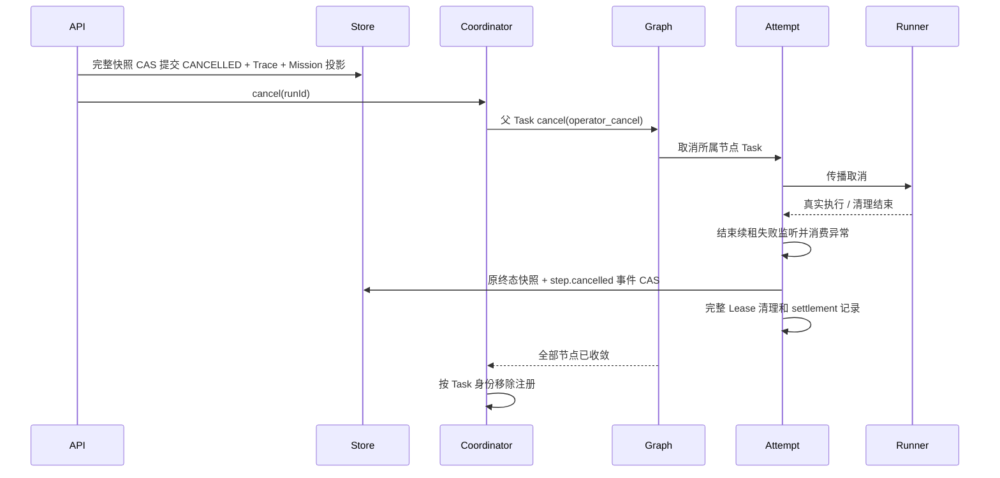
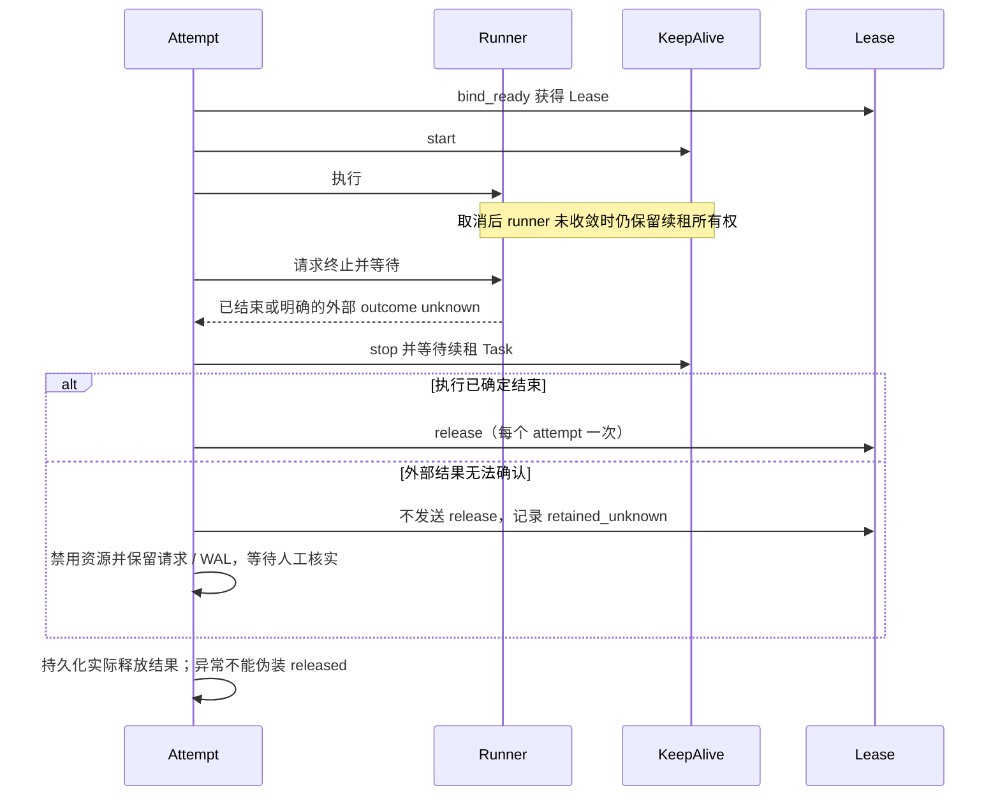

# PR-UI-04.2 — Managed Execution Cancellation & Task Settlement

状态：BLOCKED（Agent 全量门禁未通过；未提交、未推送）。

## 1. 修复目标与起始状态

- 仓库 `zongxi-Li/zhiyi-AgentOS-2026`，分支 `master`。
- 起始 HEAD：`935b121a9a979043ba9538b7ca2d1f8f19784f4e`。
- 起始工作区、暂存区及 untracked 均为空；本轮没有覆盖用户已有修改。
- 本轮处理 Coordinator → Runtime → ACG → Runner → 外部调用的取消传播、任务收敛、Lease 清理及迟到状态写入。
- Mission 状态聚合、TaskPlan 真源、ACGExecutionGraph 真源、Run/Step/Attempt 身份、Permit、Run Fence 和前端布局均沿用既有合同。

## 2. 原始问题与失败证据

先新增真实 API / Coordinator 后端集成测试，再修改生产代码。测试使用生产 Runtime 装配、真实 Coordinator、实际 ACG 图、真实临时 SQLite，通过 asyncio.Event 控制 Agent 阻塞及取消后的清理结束点。

修复前 `test_api_cancel_settles_acg_children_before_releasing_lease` 失败：API 200、Run CANCELLED；父 Task 已结束，runner 与续租失败监听 Task 未结束，runner 未收到取消，但 Lease 已释放。

原始证据保存在本机 `C:/Users/LZX/AppData/Local/Temp/pr-ui-04.2/before/`：`repro.log`、`managed-cancel.json`。这些文件未作为生产源码提交。

根因：`asyncio.wait()` 不拥有传入 Task 的取消生命周期。ACG 只在续租失败路径显式取消 runner，没有在外层取消和其他退出路径统一等待全部子 Task；随后 finally 提前停止续租并释放 Lease。相同的 Task 所有权问题也存在于提前关闭图事件流、线程池 Future、延期规划线程和 Hands 取消 ACK 的处理边界。

对本轮新增的远端收敛分支补充了第二个明确反例：通用远端 `/execute` 取消期间返回 HTTP 202，仅检查成功状态码会误认为执行已收敛。`before/remote-202.log` 保存了该失败；补丁要求非 202 成功响应且 AgentOutput 合同有效，否则报告 outcome unknown；`after/remote-202-fixed.log` 对应通过。没有把 ACK 当作执行停止证据。

迭代中的清理元数据保存曾引入重复终态事实：`save_run()` 会自动发出包含 updatedAt 的 run.finished，造成一次取消产生两条事实。新增真实集成断言以 `2 != 1` 失败（`before/duplicate-terminal-fact.log`）；清理记录改用 `save_run_with_events(candidate, [], expected_snapshot=latest)`，只更新事实并保持完整 CAS，不制造新的生命周期转换。对应 `after/duplicate-terminal-fact-fixed.log` 通过；该断言永久保留。

## 3. 修改文件与必要性

| 文件 | 必要性 |
|---|---|
| `apps/agent/app/execution/coordinator.py` | 区分 operator_cancel / worker_shutdown，避免重复取消打断清理，按 Task 身份移除注册并消费异常 |
| `apps/agentOS/src/components/executor/graph.py` | 所有超步退出路径及事件流关闭均取消并等待本图拥有的节点任务 |
| `apps/agentOS/src/runtime/acg_execution.py` | runner / 续租监听的共同所有权、完整资源清理、原因和 settlement 记录、终态事件合并 |
| `apps/agentOS/src/components/scheduler/binder.py` | 为既有续租 Task 增加 Lease 身份名称，以便精确检查残留任务 |
| `apps/agentOS/src/support/async_tasks.py` | 提供等待已有 Task、延迟重复取消直到清理结束、取消并等待以及线程实际收敛的窄工具 |
| `apps/agentOS/src/support/stores/{workflow_store,memory_workflow_store,sqlite_workflow_store}.py` | 为 Run + 事件原子提交补充可选完整快照 CAS，冲突不写 Run / Mission / Outbox |
| `apps/agentOS/src/runtime/workflow_runtime.py` | 延期规划线程必须真实结束后才能移除取消信号；只调整现有 to_thread 等待边界 |
| `apps/agent/app/execution/model_runtime.py` | Future 取消不能停止线程池中的同步模型调用；保留线程所有权直到调用返回 |
| `apps/agentOS/src/adapters/http_transport.py` | 等待阻塞 HTTP 线程结束，取消期间打开的响应仍须关闭 |
| `apps/agentOS/src/adapters/resource_execution.py` | HTTP 断连不能证明远端停止；取消后等待响应，歧义结果明确为 unknown |
| `apps/agentOS/src/adapters/hands_http.py` | 并行发送取消请求，等待终态并校验回执；取消 ACK 不作为执行终止证明 |
| `apps/agent/app/tools/formal_workspace.py` | Hands 内层 Lease 也须等待实际执行回执；保留回执及 unknown 请求证据，歧义资源禁止自动复用 |
| `apps/agent/tests/test_managed_execution_settlement.py` | 真实 API → Coordinator → Runtime → ACG 的确定性并发与异常注入集成测试 |
| `apps/agent/tests/test_execution_adapter_settlement.py` | 线程、HTTP、Hands、重复取消、事件流关闭的所有权与终态证明测试 |
| `apps/agentOS/tests/support/test_execution_settlement_persistence.py` | Memory / SQLite 完整快照 CAS、幂等事件和终态保护合同 |
| `apps/agent/tests/test_data_paths.py` | 静态路径测试在独立进程导入应用，并按真实关闭顺序释放自己创建的 Runtime / 实例锁 |
| `apps/agent/tests/test_model_runtime.py` | 对齐仓库既有“high 与 max 分别保留”合同，同时严格验证两种值，不改生产模型策略 |
| `apps/agent/tests/test_execution_runtime_application_wiring.py` | 严格插件集合补入基线已存在的 workspace 插件，仍使用完整集合相等断言 |
| `apps/agent/tests/test_runtime_streaming_production_e2e.py` | 补齐 Runtime Planner 模拟响应；真实订阅完成后执行，首段实际交付后才释放 Provider；保留并加强正文泄漏检查 |
| `apps/agentOS/tests/test_acg_execution_graph.py` | 记忆元数据完整字典加入基线已有的 retrievalFallbackReason=None，保留禁止记忆正文泄漏断言 |
| `scripts/freeze_gate.py`、`apps/agentOS/tests/storage/test_freeze_gate_integrity.py` | 补齐真实回归映射和外部测试源码指纹，支持跨目录完整收集与执行；原始 INT-1 基线不移动 |

额外调整 Runtime 线程、模型与 Tool Adapter 的原因是：只回收 ACG Python Task，不能证明它启动的线程或远端进程已经停止。这些边界属于同一取消链，未重构 Planner、Dispatch、Permit、Fence 或 Mission 生命周期。

`state_persistence.persist()` 已审计，其终态保护继续由 WorkflowStore 执行；未增加另一套状态权威。`agentos_v2.py` 的顺序继续是先原子提交 Run CANCELLED，再请求 Coordinator 取消。

## 4. 原始任务所有权模型

Coordinator 拥有父 Task；图拥有节点 Task；ACG 节点又创建 runner 和续租失败监听 Task。图原来只在部分退出路径回收节点，ACG 在父级取消时未回收其内部 Task。线程 Future 和远端取消 ACK 又进一步弱化了“父 Task 结束”所能证明的事实。

## 5. 修复后的任务所有权模型

- Coordinator 保持一个 Run 至多一个有效托管 Task；旧 Task 的完成回调只删除自己，不能删除替代 Task。
- Graph 的 try/finally 覆盖整个超步，包括 yield 期间的关闭和消费方异常；收敛后清空 active_step_ids。
- 每个 ACG attempt 等待 runner 和续租失败监听结束，再进入完整 Lease 清理。重复取消只能延迟传播，不能让已创建的清理任务失去所有者。
- 正常完成、异常、取消及资源清理错误均消费已创建 Task 的异常。实际清理错误保留日志和可写入时的 settlement 记录。
- 模型 / HTTP 线程保留所有权直到线程真实返回；延期规划同样等待线程结束后才清除取消信号。
- Hands 拥有执行、取消请求及 admission 等待 Task；取消发生于 admission 前后都要等待原执行路径验证终态回执。无法确认外部停止时保留 WAL，禁用既有资源 profile，不伪造 release。

## 6. 取消传播时序

API 的成功表示取消命令已持久化；执行 Task 和 Lease 的收敛由各自所有者完成，不能把 API 200 当作外部进程停止回执。

## 7. Lease 生命周期

续租停止报错时仍尝试清理已确认结束的 runner 所属 Lease；释放失败记录 release_failed 并保留错误。Lease 的 TTL / 分布式协调机制沿用既有实现，没有引入新的基础设施。

## 8. 取消状态、进度与 Trace

- WorkflowStore.RuntimeRunRecord 是 Run 生命周期权威。Runtime.cancel 的完整快照 CAS 和提交后发布信号顺序不变。
- ACG 收敛时先读真实终态；不再从旧执行快照制造另一个 CANCELLED Run。原有 Trace、已完成步骤、输出引用和取消命令记录保留。
- 迟到的运行态 / 完成态仍由 Store 终态保护拒绝；终态之后允许补充的 step.cancelled 事件通过新鲜快照 + 完整 CAS 原子提交。
- 原有 StepExecutionId / AttemptId / RunId 和事件 ID 继续使用，重复事件不追加第二份事实。
- operator_cancel、sibling_failure、lease_renewal_failure、worker_shutdown、review_interrupt 等原因从真实控制路径传递，不再统一记为 sibling failure。
- taskSettlement 只记录真实任务和 Lease 清理事实，不作为执行授权或新的生命周期状态机。
- 未持久化的取消、revision 冲突和 Outbox 失败不能提前触发取消信号或覆写安全合同。已提交终态之后的清理错误不把 Run 改回 RUNNING / COMPLETED。

## 9. 新增测试与复现迭代

真实托管链覆盖：阻塞 runner、延迟清理、两个 successor 独立运行、迟到成功、重复 / 并发取消、关闭与取消竞争、自然完成竞争、runner 启动前取消、续租失败与取消竞争、延期规划线程、已完成步骤 / 输出 / Trace 保留，以及提交、取消 Outbox、释放、runner 清理和续租停止错误。

Adapter 测试覆盖：线程真实退出、HTTP 响应打开期间取消后的关闭、远端响应与 unknown、Hands admission 前后取消、ACK 尚未终态、重复取消、验证回执和 unknown，及图事件流关闭时兄弟 Task 收敛。

Memory / SQLite 测试覆盖：同 revision 的快照差异仍触发 CAS、冲突时 Run / Mission / Outbox 不变、取消事件幂等和旧 ACG 状态不能覆写终态。

测试中使用 Event、真实完成状态和回执控制时序；没有新增用生产 sleep 充当收敛保证的逻辑。Hands 原有轮询间隔保留，完成依据仍是实际终态及回执校验。

早期复现后曾有测试夹具错误：三节点模板与原有单节点模板同时注册，Planner 合法选中了原有模板，B 未启动；改为替换被选中的模板并保留规范 TaskPlan 关系后验证。初次 Hands 测试还暴露了在状态请求阻塞期间需要独立发送取消请求，以及重复取消期间不能跳过回执处理，均已补充回归。

### 全量基线故障与必要的测试基座修正

首次完整 Agent 运行：390 passed、26 failed、62 errors。首次完整 AgentOS 运行：2185 passed、3 failed。没有将这些失败计作通过。

在独立干净检出 `C:/Users/LZX/AppData/Local/Temp/pr-ui-04.2/baseline`、HEAD 同为 `935b121a` 时分别复现了实例锁污染、模型档位旧断言、两项 SSE 失败，以及三项 AgentOS 门禁/旧元数据断言失败。证据为 `before/baseline-existing-failures.log`、`before/baseline-agentos-failures.log`；生产取消补丁不在该检出中。测试基座修正单独在该基线检出得到 13 passed（`after/baseline-test-repairs.log`）。

1. `test_data_paths` 导入 main 会真实构造 Runtime，原测试未关闭，造成后续不同数据库的夹具被实例锁正确拒绝。修正隔离该导入并正常关闭所有构造层，没有清零或强行解锁生产实例锁。
2. 既有 `test_llm_capabilities.py` 已要求 high / max 分别保留；旧 completion_options 测试却要求 high 被改为 max。对齐该既有合同并增加 max 的严格断言，生产模型配置未改。
3. SSE 的旧字符串检查把合法的 Prompt SHA-256 / 版本字段当作正文。现先严格验证有限的公开元数据格式，再执行原正文检查，并额外递归检查真实请求消息正文没有出现在事件字符串值中；加入非法哈希、版本正文、reasoning 内容和带引号正文的拒绝反例。
4. 模拟 Provider 原先不支持 RuntimePlanningDecision，因此正确进入 WAITING_REVIEW，测试却等待 run.completed。补齐由真实 observationId、remainingStepIds、completionBlockers 决定的测试响应，不改 Runtime Planner 或生产事件协议。
5. SSE 测试先启动执行再等待 HTTP 握手会丢失订阅前的首段，属于测试竞争。现在根据真实 Broker 队列注册信号启动执行；Provider 以首段实际交付的 Event 为继续条件，替换测试中的固定延迟。保留首 token / delta / planner.completed / node.started / run.completed 的原有时序断言，并消费执行任务异常。
6. 冻结门禁原始 INT-1 清单的 SHA-256 `54ccc02a3d0ba550fffff8dd23f259460977ae0a75f3d8eea4d7c1848ce1a591` 保持不变；补入遗漏映射。wiring.py 生产源码相对本轮起点未改，在实际装配、失败清理和 schema 回归后更新其过期外部摘要。新增执行所有者摘要、真实跨目录收集/执行对抗及外部测试文件指纹，避免只登记路径却漏跑 App 集成测试。没有修改 300 秒预算、排除规则、失败分类或基线认证规则。

## 10. 完整验证结果与源码快照

本轮最后一次验证固定 apps 与 scripts 下全部受 Git 管理及新增非忽略文件，共 2242 个文件。逐文件原始字节 SHA-256 清单的摘要为 `074fa4b63fe3c1548006ff6608b1a6ff469590d1f6e612e0f66749f8ce02347c`。清单、命令、退出码、耗时及日志保存在本机 `C:/Users/LZX/AppData/Local/Temp/pr-ui-04.2/verified/`；该目录在仓库外，没有作为源码或测试结果文件提交。早期失败和未完成的探索运行保留在 before / after，不作为最终通过证据。

验证环境为 Windows、Python 3.14.5、pytest 8.4.2、pytest-asyncio 1.4.0、Pydantic 2.13.4、FastAPI 0.136.3、httpx 0.28.1、langgraph 0.6.11；前端使用 Node 24.19.0 / npm 11.17.0。没有变更依赖清单或安装新运行依赖。

| 验证 | 实际结果 |
| --- | --- |
| 真实托管执行 / Adapter / Coordinator / Memory、SQLite 定向 | 48 passed |
| 前端全量 `npm test -- --maxWorkers=2 --minWorkers=1` | 143 files / 1053 tests passed |
| `npx vue-tsc -p tsconfig.json --noEmit` | exit 0 |
| `npm run build:web` | exit 0 |
| Java Run API / Gateway / capability / 序列化 / 投影边界 / 路由兼容 | 26 tests，exit 0；不等同 Java 全量 |
| Local Runtime 全量 | 52 passed、1 skipped；原有 Windows 无法创建 symlink 的环境跳过 |
| Agent 全量 | **18 failed、406 passed、62 errors；exit 1** |
| AgentOS 全量 | 2200 passed、3 warnings；exit 0，2347.12 秒 |
| PR-UI-04.1 分支、Run capabilities 与 Memory / SQLite Store 合同独立复验 | 115 passed |

全部上述命令结束后重新生成源码清单，2242 个文件及总摘要均与验证前相同，`changedPaths=[]`。最终 `git diff --check` 通过；暂存区为空，没有未合并文件。新测试在真实执行循环内断言相关 owned Task 已结束、事件循环异常处理器未收到未消费异常；最终 verified 日志扫描未发现 Task/Future exception was never retrieved、Task was destroyed、coroutine was never awaited 或未处理 Promise rejection。测试进程及其子进程已结束，Python 进程清单仅保留本轮开始前的 4 个 ZhiyiNative 开发进程，本轮没有停止或重新部署这些实例。

### Agent 全量剩余阻断项与边界

1. 共享测试 Provider 仍解析 `Mission requirements: ... / Semantic profile: ...` 旧文本，实际 `TaskDecomposer.build_prompt()` 已返回 JSON，请求到达 Mock 时触发 `IndexError`，修复重试也失败。独立基线检出运行 domain pack 测试同样得到 2 failed / 2 passed（`before/baseline-planning-mock.log`）。仅在仓库外基线检出尝试按 `planningRequest` / `capabilityCatalog` 解码后，通用 native 流程通过；**该探索改动没有复制到本轮主工作区**。
2. Programmer 模板在基线和探索中均报 `task requirement-analysis requires missing predecessor capability task_understanding`。此问题涉及模板与 Capability 依赖合同，不能通过本轮改写 TaskPlan 来源或放宽拓扑约束解决。
3. 当前全量中最先遗留实例锁的是 `test_general_golden_recovery`：它受第 1 项 Mock 解析错误阻断，而 `close_runtime(first)` 仅在正常执行路径末尾；后续 Legal、托管执行夹具和 Mission 测试均被这个临时 DB 的锁阻断。另在独立基线按新 JSON 格式修正 Mock 后，Legal 旧 golden 测试构造的 TaskPlan 只有节点而没有关系，真实 Blueprint 含依赖边，被语义保真检查以 `Blueprint adds undeclared semantic dependency` 拒绝；它同样只在正常末尾调用 `close_runtime()`，后续测试也产生实例锁级联错误。独立基线重现日志为 `after/baseline-planning-mock-fixed.log`（3 failed / 3 passed）；路径指向基线检出的临时数据库。没有强制解锁、清空全局锁或绕过保真验证。
4. 本次还出现一次 `test_upsert_inline_profile_and_delete_active` 的 Windows `os.replace()` PermissionError；未证明其为取消补丁回归，也未把它作为通过处理。

这些证据足以拒绝“全量已通过”的结论。独立基线的探索只用于归因，不属于最终源码快照。尚未逐项证明所有剩余失败均由同一根因导致，不作此声明；不删除、跳过测试，不更改 Planner、TaskPlan、模板或实例锁生产合同来制造绿灯。

## 11. 风险与验收范围

- Python 协程无法强制终止正在执行的同步线程。实现保留 Task / Lease 所有权，等待有底层超时约束的调用实际返回；不会把 Future 已取消当作线程已退出。
- 外部传输可能产生 unknown；该路径保留证据、禁用资源并要求既有恢复流程人工核实，不保证远端物理进程已停止，不自动重放或自动重新启用资源。
- 本轮自动化验证不代替真实模型、实际远端设备、Linux Runner、桌面或生产部署验收。
- 已有测试、状态机约束、Permit / Fence / Dispatch 合同和 PR-UI-04.1 门禁均保留；未更改前端源码。

## 12. Git Commit SHA 与 Push

本轮附件包含阶段 E 的提交和推送授权。但阶段 D 的必要全量门禁尚未通过，因此阶段 E 暂未执行。工作区保留全部实现、回归测试和本记录；未部署，未修改远端。后续须先闭合上述阻断项并在同一源码快照重新通过必要门禁，才能标记 SELF-TESTED 或 READY-FOR-REVIEW。
