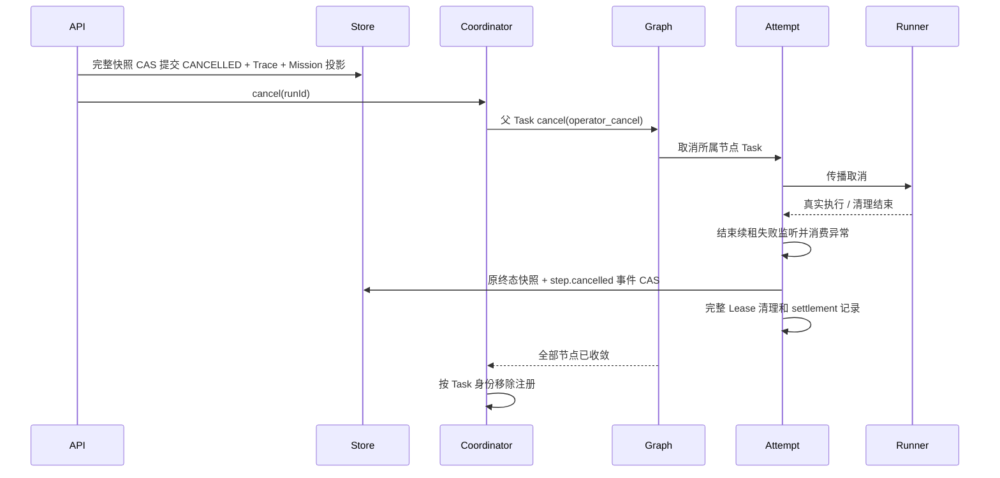
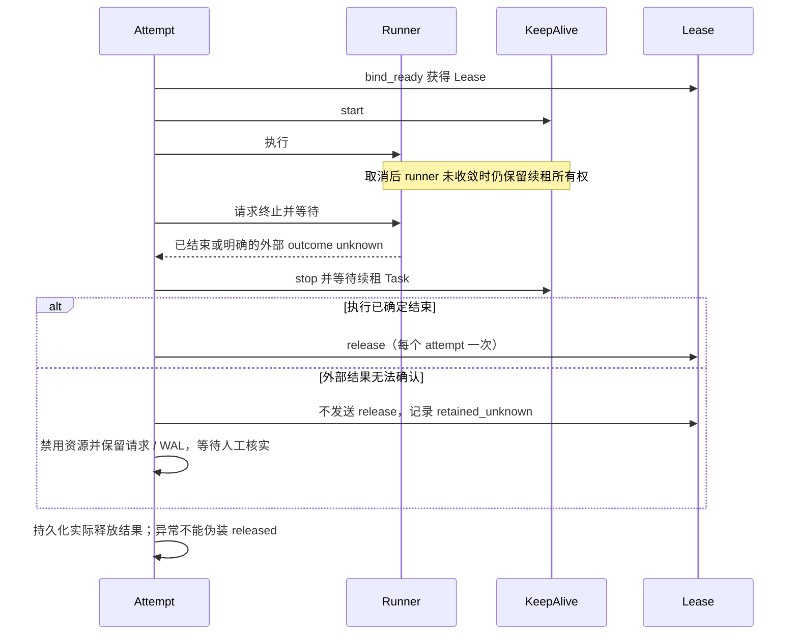

# PR-UI-04 系列 运行权威与受控执行：实施与回归修复合并记录

> **文档性质**：阶段证据合并稿——实施记录 3 篇 + 回归修复 1 篇
>
> **覆盖时间**：2026-11-02 ~ 2026-11-03
>
> **当前定位**：Mission 生命周期操作权威（capabilities 投影 → 分支安全投影 → 托管取消）的原始记录；04.2 的后续修复（R2）进行中，见 0.1 末条
>
> **合并日期**：2026-11-03

## 0. 合并说明与导读

本册把 **PR-UI-04 系列（2026-11-02 ~ 11-03）** 的 4 篇记录合并为一篇：Run Authority & Action Capabilities、Branch-safe Mission Lifecycle Projection、Managed Execution Cancellation & Task Settlement、R1 回归门禁与历史兼容修复。正文逐字保留原文，仅做两类机械处理：标题层级下移一级、指向已合并/已归档文档的相对链接改写（经查本册原文均无站内相对链接，未发生改写）。来源清单见文末附录。

### 0.1 这一阶段在解决什么

本系列沿 UI-03（见 [PR-UI-03](PR-UI-03-MissionLifecycleExperience实施记录-2026-11-01.md)）证实「Mission 缺 current 执行权威」的合同缺口，分四步推进：

1. **UI-04 Run Authority & Action Capabilities**（11-02）：后端提供逐 Run 的能力事实（只读 capabilities 投影，Python v2/C2 API + Java 增量 DTO/白名单 mapper），前端按动作恢复控制；无法证明唯一执行分支时有意不提供 Current Run/Branch Head，Latest 只作展示。
2. **UI-04.1 Branch-safe Mission Lifecycle Projection**（11-02）：先复现再修复「取消一个 Run 经 Mission 级终态迁移决定成败」——取消改为分支安全，其他分支仍可合法执行、完成、审核或取消；兼容 Mission.status 只作确定性汇总。
3. **UI-04.2 Managed Execution Cancellation & Task Settlement**（11-02 ~ 03）：托管取消与任务结算。首次验证因 Agent 全量失败如实记 **BLOCKED**；随后按用户指示提交并推送（`683e7e16` / `4e26cf52` / `a1b5a6a9`），原文明确提交不改变 BLOCKED 结论。
4. **UI-04.2-R1**（11-03）：按用户收缩后的必要范围补回归门禁与历史兼容修复（测试清理、Mock 合同、历史记录兼容、真实剩余故障）。整理当日（11-03），04.2-R2 在分支 `fix/pr-ui-04-2-r2-p1-safety` 仍在进行，成稿后另行登记，不在本册。

### 0.2 一页结论

| 篇目 | 性质 | 结论 | 关键证据 |
|---|---|---|---|
| UI-04 | 实施记录 | SELF-TESTED：逐 Run capabilities 事实 + 前端能力校验，关闭优先 | 2225 文件源码快照 0 差异；Java/Python/前端定向门禁通过 |
| UI-04.1 | 实施记录 | SELF-TESTED：分支安全生命周期投影，取消不误伤其他分支 | 原始故障先复现再修复；2227 文件快照 0 差异 |
| UI-04.2 | 实施记录 | 首验 BLOCKED（如实保留）；已按用户指示提交推送 | 提交 `683e7e16` / `4e26cf52` / `a1b5a6a9` 经 live refs 核验；提交不改变结论 |
| UI-04.2-R1 | 修复记录 | SELF-TESTED（按收缩范围）：八项结果 receipt exit 0 | Agent 493 全量、169 组合定向、Java 26 定向、前端 1053 全量；AgentOS 全量未完成 |

### 0.3 贯穿全阶段的不变量

- Capabilities 是查询时的 UI offer，可能过时；不是授权令牌，命令端既有版本、身份与 Authority 检查始终必需。
- 不制造唯一 Current Run / Branch Head；Latest 只作展示；缺可信 scope、缺正式证据、同版本冲突时操作保持关闭。
- Mission 级汇总按既有 Run 状态集合确定性计算，不新增持久化计数或隐式 Branch Head。
- 失败 / BLOCKED / 中断如实保留：不把缺失的全量退出码推断为成功，不用进程消失或范围收缩制造通过。

### 0.4 明确未完成与放行条件

- 全系列等待独立复验；04.2 首验 BLOCKED 结论未撤销。
- R1 按用户明确收缩范围：AgentOS 全量与 300 秒正式 freeze_gate 未取得本轮通过结果，175 项定向不等同正式冻结验收。
- Windows 原始 os.replace 错误未复现，不声称根因已修复；域模板更改只影响后续准备的执行计划，历史 Blueprint 与任务状态不批量替换。
- 04.2-R2 进行中（分支 `fix/pr-ui-04-2-r2-p1-safety`），不在本册。

### 0.5 阅读建议

按 UI-04 → 04.1 → 04.2 → R1 顺序读，先看各篇结论与尚存限制。想知道「现在能否安全取消一个 Run」，读 04.1 的未解决问题一节与 04.2/R1 的取消结算部分。

## 篇目与阅读顺序

1. **PR-UI-04｜Run Authority & Action Capabilities 实施记录** — 实施记录，2026-11-02 — 原文件 `PR-UI-04-RunAuthorityActionCapabilities实施记录.md`
2. **PR-UI-04.1｜Branch-safe Mission Lifecycle Projection 实施记录** — 实施记录，2026-11-02 — 原文件 `PR-UI-04.1-BranchSafeMissionLifecycle实施记录.md`
3. **PR-UI-04.2｜Managed Execution Cancellation & Task Settlement 实施记录** — 实施记录，2026-11-02 ~ 11-03 — 原文件 `PR-UI-04.2-ManagedExecutionCancellation实施记录.md`
4. **PR-UI-04.2-R1｜回归门禁与历史兼容修复** — 修复记录，2026-11-03 — 原文件 `PR-UI-04.2-R1-回归门禁与历史兼容修复记录-2026-11-03.md`

---

## 1. 原文｜PR-UI-04｜Run Authority & Action Capabilities 实施记录

<!-- 原始记录：PR-UI-04-RunAuthorityActionCapabilities实施记录.md -->

日期：2026-11-02。最终状态：**SELF-TESTED**；不代表独立 ACCEPT。

### 1. 入场与修改保护

- 分支 `master`，入场 HEAD、`origin/master` 均为 `1d5969cf97c0e6d028434016c5c530a75fb027a5`。
- 入场暂存区、untracked 为空。已有用户修改是删除 `docs/架构设计/架构图/知弈AgentOS-ACG架构图.png`（HEAD 中 220008 字节）；保持原样，不属于本轮清理范围。
- 重新读取 PR-UI-03 实施记录并沿当前源码核验，未使用历史设计建议代替运行合同。
- 本轮未 Reset、Checkout、Stash、Clean，未提交、推送、合并、部署，未修改业务数据。

### 2. 真实分支语义与决策

运行状态权威是 WorkflowStore 的 RuntimeRunRecord。Identity Graph / Workspace 是可延迟的身份投影；不能以其更新时间、选中标记覆盖运行状态。

| 路径 | 真实语义 | 是否替代来源 Run |
| --- | --- | --- |
| 初始 Mission / Run | 创建独立运行快照及幂等身份 | 无来源 |
| POST missions/{missionId}/runs | 终态来源创建新 Run，保留来源链 | 否 |
| retry_failed_step / successor_run | 校验已提交输出、失败步骤与版本，再创建后继 | 否 |
| public current_run | 本轮关闭公开原地重试，返回 409 | 不再开放 |
| Runtime Planner 内部恢复 | 原有 reuse_source_run 内部恢复权威 | 保留内部合同 |
| Mission Revision 后继 | 旧 Run 取消后，按修订决定创建后继 | 来源关系，不等于 supersession |
| Review rerun | 原有 Review Authority 创建后继 | 来源关系 |
| Graph patch | semantic_revision 与 save_graph_patch_transition 原子保存来源 SUPERSEDED、双方替代关系及 outbox | 是 |
| Cancel / Delete / Review / Formal | 当前 Run、当前权限和对应原有权威重新检查 | 不根据 UI 能力授予权限 |

同一 Mission 可以有多个活跃 Run，同一 sourceRunId 可以有多个不同 successor。SQLite `save_prepared_run_once` 使用 BEGIN IMMEDIATE 与请求键/指纹保证同一请求重放；它没有“同一来源只能一个后继”的约束。真实临时 SQLite 并发测试和重新打开数据库、独立 Python 进程读回测试证明了这一点。

因此不增加单一 currentRunId，不增加 Mission Branch Head，不以 selected/latest 作为授权。parentRunId、sourceRunId 表示来源；supersedesRunId、supersededByRunId 才表示显式替代。MissionRunRevision.status=CURRENT 仍只表示语义修订状态；WorkspaceRunSummary.isActive 保持旧的选中含义。

### 3. Action Capabilities 完整合同

Run 查询及现有 Workspace 每个 Run 行增加可空 `actionCapabilities`。旧服务端没有字段时，前端关闭相关操作；Java 只透传白名单 DTO，不创造能力。服务端只计算，不持久化，不接受客户端提交的 capability 作为权限。

```typescript
interface RunActionCapabilities {
  schemaVersion: 1
  missionId: string
  runId: string
  runtimeRevision: number
  status: string
  isExecutionActive: boolean
  isSuperseded: boolean
  lineage: {
    parentRunId?: string | null
    sourceRunId?: string | null
    supersedesRunId?: string | null
    supersededByRunId?: string | null
  }
  canInspect: boolean
  canDiscuss: boolean
  canCancel: boolean
  canReview: boolean
  canExecuteFormalAction: boolean
  formalActions: Array<'materialize' | 'activate' | 'handoff' | 'permit' | 'dispatch'>
  canResolveToolApproval: boolean
  canAnswerPlanner: boolean
  canCollaborate: boolean
  canRetrySuccessor: boolean
  retryStepId: string | null
  canRerunSuccessor: boolean
  canDecideRevision: boolean
  canApplyRevision: boolean
  canDelete: boolean
  unavailableReasons: Array<{ action: string; code: string }>
}
```

原因使用定型列表而非任意字典，遵循现有 Java 投影白名单边界。原因包括 TRUSTED_SCOPE_UNAVAILABLE、IDENTITY_SCOPE_CONFLICT、UNKNOWN_STATUS、RUN_SUPERSEDED、MISSION_NOT_ACTIVE、RUN_NOT_ACTIVE、SNAPSHOT_CHANGED、AUTHORITY_DENIED、AUTHORITY_UNAVAILABLE，以及 Review / Formal / Recovery 的证据不足原因。

能力按各自条件计算：

- Inspect / Discuss：可信用户、租户、冻结 owner 与原有语义读权限匹配。
- Cancel：真实 active 状态、原有写权限；不要求先同意 Copilot 任务协作。
- Review / Planner answer：真实 checkpoint、Run/review payload、原有状态引用校验、具体 subject；不会因为能 Cancel 就能 Review。
- Formal：原有 require_c2、当前语义 basis、Planning/Materialization/Activation/Handoff/Permit/Dispatch 的现有只读校验共同证明下一步。
- Tool approval：实际运行的 Permit Run、现有审批服务中属于该 Run 的 pending 事实。
- Retry successor：真实失败步骤，复用 Recovery Coordinator 的 validate_only 校验；返回确切 retryStepId 与源版本。Permit 执行的内部恢复不能安全等同公开 partial successor，保持不可用并给出原因。
- Rerun successor：可用终态来源的新快照提交，实际命令仍执行原有准备和语义检查。
- Revision decision / apply：原有语义快照、决定收据、目标修订、用户和租户；取消后才开放符合条件的 apply。
- Delete：终态 Run 与现有 Mission 写权限。

未知状态、缺 owner/租户证据、身份冲突、明确 superseded 或查询过程中运行版本变化均关闭变更能力。显式 superseded 保留查看/讨论，不能恢复为原地执行目标。

### 4. 后端权威与命令路径

可信上下文仍来自原有 InternalServiceAuthMiddleware / Java trusted forwarder，不从请求布尔值推断用户。租户为空只在现有 semantic authority 能证明 `__unscoped__` 命名空间时兼容，缺字段本身不能授予权限。

`app/execution/run_capabilities.py` 是只读投影器；不创建新执行状态机或授权记录。GET Run 从 WorkflowStore 读取状态和同版本能力；Workspace 逐 Run 独立计算，不能把 selected 行的能力套给其他行。Identity 普通延迟不覆盖运行状态；明确 Mission 身份冲突或删除事实会关闭能力。

命令仍重新经过原有 owner/tenant、Mission write、Runtime / Review / C2 / Revision Authority。公开原地重试关闭，但内部 Planner 恢复未改。旧请求的 operationId、clientRequestId、幂等键、请求指纹保持原合同。已接受 successor 的同身份重放先返回原结果，不因之后来源状态改变而丢失已提交任务。

Cancel 可携带可选 expectedRuntimeRevision；Java 校验非负并透传，Python 在既有 Run 锁内、写取消信号前比较版本。终态公开 Cancel 返回原有固定 409 文本；内部重复 CANCELLED 返回当前记录，不追加历史 Trace。其余 Runtime 修改仅限这一处局部检查，未重构 Scheduler、Planner 或 ExecutionBackend。

没有新增持久化事实、表、索引或 Schema 迁移。能力未写入 executionState；WorkflowStore 事务及真实运行权威保持原样。

### 5. 前端恢复与冗余清理

`runCapabilities.ts` 校验 schema、Run/Mission、版本、状态、所有布尔字段、formal action 和状态一致性；lifecycleProjection 在 Run detail 与 Workspace 中选择匹配的新事实。同版本能力冲突时关闭操作，明确替代证据不会被旧 detail 反向抹除。

WorkbenchContext 只派生已有能力，没有新增 Store。停止、Review、Formal、Tool approval、Planner answer、Revision、Delete 分别判断。终态来源可创建新 successor，但不把来源重新变成运行目标。停止会捕获版本并在对话框返回后检查选中身份；后续刷新真实事实，不拼接乐观状态与旧能力。

恢复操作在 await 前捕获能力、失败步骤和版本。过期目标不会偷偷改步骤、改成完整重跑或换身份；不确定请求继续用原快照恢复。Copilot proposal 也必须匹配其原始 Run 与版本。

保留既有 FormalExecutionControls 链。修复一个真实 UI 缺口：没有 C2 formalControl 的普通 active Run，拥有 canCancel 时也能显示并触发停止按钮。单独区分任务执行同意和安全停止；前者仍约束正式执行、Review、工具操作，不能意外隐藏合法停止。

界面显示 Selected、Latest created、Active Runs、Lineage；不再制造 Current 执行权威。Editor Follow、canonical Artifact 身份、Run URL、请求代次、KeepAlive/双视图连续性和 SSE 清理仍受现有集成测试约束。RunProgressEditor / Registry 无需创建平行控制链，沿现有 Context / EditorGroup 传递即可。

按用户追加要求清理本轮相关冗余：删除空置 currentRunId/isCurrent/恒定缺失标记、无用 status 判断和 import、未调用的投影辅助函数；复用已读取的 formal control，删除重复读取与不可达 catch。未删除不相关兼容模块、视觉布局或用户文件。

### 6. 失败反例与对抗证据

证据目录：`C:\Users\LZX\AppData\Local\Temp\pr-ui-04`。失败日志保留，未删除缓存或改写测试报告。

1. `pr-ui-04-terminal-cancel-before.log`：终态重复 Cancel 原来返回成功并可能重写 Trace；修复后命令拒绝、历史记录不变。
2. `pr-ui-04-legacy-cancel-before.log`：真实 Host 集成中 canCancel=true，但普通 Run 找不到停止按钮；修复后实际点击停止按钮并检查源 Run/revision，独立分支能力不受影响。
3. `final/python.log` 保留中间扩大回归的 9 failed / 558 passed：固定错误文本兼容、C2 关闭时历史 GET、读查询新增写权限探测导致的六个旧回调断言，以及旧 Desktop blanket 子进程断言。逐项修复后才重新运行最终全门禁，不以小范围绿灯冒充扩大回归。
4. 原六个读权限合同保留撤权/恢复的拒绝与成功断言；隔离 Run body 的只读 callback，能力允许探测原有 write 权限但不得写入。新增完整 Run 记录查询前后相等断言。
5. 中间 Java 新断言误认非法输入应为 400，现有全局合同实际为 422；已改为精确 422，未放宽接受范围。

新增 Python 覆盖真实 HTTP/生产组合与临时 SQLite、同来源不同后继并发、同请求重放、重开数据库与独立进程、Memory/SQLite 状态矩阵、租户/用户/读写分离、伪造能力、来源与 supersession 区分、迟到版本、真正失败 ACG 的部分恢复、真实 Review、C2 完整阶段与旧语义修订拒绝。GET 能力不创建 Run 或正式授权事实。

新增/扩展前端用真实 Router、Pinia、WorkspaceViewHost、Registry、EditorGroup、Graph、Observation 与 SSE 测试多活跃分支、实际 Cancel 点击、动作不互相授权、缺失/冲突/旧版能力、superseded 禁止、恢复目标不得静默漂移。保留原连续性、Follow、canonical Artifact、丢失响应重放、URL/代次隔离测试；集成清理断言检查无残留 SSE。

#### 已存在的 Desktop 架构断言冲突

扩大回归原测试一律禁止 Electron 出现 child_process，但 HEAD 已由 `49e02578` 引入 LSP、Git、搜索、诊断四个 IDE helper。本轮未改 Desktop 生产源码，基线差异证据在 `pr-ui-04-desktop-baseline-diff.log`。

保留原测试名称和“不成为 Agent 执行权威”的边界，改为精确核查四个既存 helper：命名 spawn import、禁止 shell、固定命令形状、时限/输出边界、禁止携带 Run/Mission/Permit/operation 身份、禁止通用 runner 导出；同时检查 13 个 IDE IPC 的 renderer owner 和 root 校验。强化禁止引入 WorkflowStore / ExecutionRuntime / NodeRunner / ACGExecutionGraph 等权威。新增未审查进程入口、向既有 helper 注入 Run 身份两项拒绝反例，不是无条件允许子进程。额外运行四个 helper 的 26 项真实功能测试。

### 7. 最终同快照验证

最终证据在上述目录的 `release` 子目录；`delivery`、`final` 是保留的中间结果，不作为本轮最终成功凭据。

| 门禁 | 最终结果 |
| --- | --- |
| Python 后端定向 + WorkflowStore 合同 + Runtime/Architecture 扩大回归 | 570 passed，14 warnings，无失败/跳过 |
| Java Gateway/Projection/Controller/可信上下文/架构 | 70 tests，0 failures/errors/skipped |
| 前端全量 `npm test -- --maxWorkers=2 --minWorkers=1` | 143 files / 1051 tests 全通过 |
| `npx vue-tsc -p tsconfig.json --noEmit` | exit 0 |
| Desktop 四个既存 IDE helper 功能回归 | 26 passed，无失败/跳过 |
| 前端最终定向 | 18 files / 218 tests 全通过 |
| `npm run build:web` | exit 0，包含 vue-tsc 与 Vite Web 构建 |
| `git diff --check` 与未跟踪文本检查 | 工作区及 index 检查 exit 0；12 个新增文本文件无尾随空白/缺失末尾换行 |

Python 使用 `-c apps/agentOS/pytest.ini --rootdir=.`，显式绝对 pythonpath 指向 agentOS/src、agentOS、agent、runtime tests；组合运行避免 pytest 根目录导致错误 collection。`faulthandler_timeout=90` 仅打印诊断栈，不修改测试 deadline。包含 test_run_action_capabilities、test_run_capability_projection、test_run_authority_c2、v2 API/Workspace、Revision、Internal Auth、C2 HTTP/Permit/Dispatch/Human Review/Projection/Admission、WorkflowStore contract 与完整 runtime、architecture 目录。

Java 执行 RunActionCapabilitiesProjectionTest、RunProjectionBoundaryTest、WorkspaceProjectionMapperTest、WorkspaceProjectionSerializationTest、AgentOsRunControllerTest、AgentOsMissionControllerTest、AgentOsReviewControllerTest、AgentOsGatewayServiceTest、QueryProjectionArchitectureTest、MissionProjectionArchitectureTest、TrustedUserContextForwarderTest。

前端定向包含 src/workbench/runtime、MissionLifecycle.integration、MissionWorkspaceView、FormalExecutionControls、AcgCopilotPanel、MissionRevisionNotice、WorkbenchStatusBar、WorkspaceContinuity。没有删除测试、Disabled、改 excludes、降低安全断言或调整既有 deadline。

Python 14 条 warning 包含既有 Pydantic tuple/list 序列化提示，保留原日志，不算无 warning。构建输出及 warning 以 release/build.log 为准。

### 8. 源码快照与最终范围

在最终所有门禁开始前生成 `release/source-before.json`：`git ls-files --cached --others --exclude-standard apps`，按路径排序去重，逐文件 SHA-256，缺文件写 MISSING，再序列化 JSON。范围包含全部 apps 源码与测试，也包含架构检查所读取的 Desktop 基线文件。

- 文件数：2225。
- manifest SHA-256：`A0BBE0654D25FCA67C80BFB3026D0464605A7E0316B89BC8A5FAF312A88A9E97`。
- HEAD：`1d5969cf97c0e6d028434016c5c530a75fb027a5`。
- 验证后重新生成 `release/source-after.json`：2225 文件，逐路径差异 0，manifest SHA-256 与上述完全相同。核对记录为 `release/source-verification.json`。
- 最终 HEAD 未变，暂存区为空，Desktop 生产源码 diff 为空，用户原有 PNG 删除保持原样。
- 本报告位于 docs，不在 apps 源码快照内；用户原有 PNG 删除单独保护。

主要生产修改范围为 Python v2/C2 API、只读 capabilities 投影器及 Runtime cancel 的小补丁；Java 增量 DTO/白名单 mapper/可选取消版本透传；前端能力校验、生命周期投影与既有控制链。测试文件负责对抗、兼容与集成验证；没有后端 Schema、依赖版本、SSE 协议、Launcher 身份内核或 Desktop 生产修改。

### 9. 尚存限制与复验建议

- 本结果是本地自动化验证，不代表远端 GitHub CI、真实模型、真实浏览器视觉验收或生产环境已通过；没有部署。
- 无法证明唯一 Mission 执行分支，故有意不提供 Current Run/Branch Head；Latest 只作展示。
- 缺可信 scope、缺正式证据、同版本冲突时仍关闭操作；权限恢复或新事实到达后再刷新。
- Permit Run 的公开 partial successor 未伪装为内部恢复，仍关闭；用户可在合法完整快照条件下创建新 Run。
- Capabilities 是查询时的 UI offer，可能过时；不是授权令牌，命令端的现有版本、身份和 Authority 检查始终必需。
- 独立复验应优先尝试多活跃分支、旧 Run 请求迟到、撤销权限、过期版本、同请求重放和显式 supersession；不应只看按钮显示。

### 10. 结论

**SELF-TESTED**。所列门禁全部通过，且最终源码快照一致，可以提交独立复验。后端提供逐 Run 的能力事实，前端按动作恢复控制；没有制造唯一 Current Run，也没有将 UI 能力当作命令授权。部分恢复无法满足正式执行权威时仍保持关闭。

本轮未 Commit、Push、Merge 或部署；未自行宣布 ACCEPT。


---

## 2. 原文｜PR-UI-04.1｜Branch-safe Mission Lifecycle Projection

<!-- 原始记录：PR-UI-04.1-BranchSafeMissionLifecycle实施记录.md -->

日期：2026-11-02。最终状态：**SELF-TESTED**，等待独立复验。

### 1. 入场与失败复现

入场分支 master，HEAD 与 origin/master 均为 `f6e3e4c7289f134682095b617c470194eb60ec4e`。工作区、暂存区、untracked 均为空。本轮没有覆盖原有修改，也没有 Reset、Clean、Commit、Push、Merge 或部署。

先新增 `apps/agent/tests/test_branch_safe_mission_lifecycle.py` 的真实 HTTP / SQLite 失败测试，运行失败后才改生产代码。使用生产组合、可信用户中间件、真实 WorkflowStore、RunExecutionCoordinator 和测试 Agent：

1. 创建 Mission，等待初始 Run 的真实 coordinator Task 完成，确认来源 Run 与兼容 Mission 均为 COMPLETED。
2. 暂停 coordinator.submit，并发提交不同 clientRequestId 的两个 successor。
3. 从 WorkflowStore 读取完整 Run，确认两个 PENDING；通过真实 GET 查询，两个 canCancel=true。
4. 携带原 runtimeRevision 调用取消接口，得到 409。来源 Mission 仍 COMPLETED，目标 Run 仍 PENDING，但目标取消信号已为 true。

原始证据保存在 `C:\Users\LZX\AppData\Local\Temp\pr-ui-04.1\before`：

- `pending-cancel.log`：1 failed，真实 API 返回 409。
- `pending-cancel-snapshot.json`：取消前的 Mission、来源完整 Run、两个分支完整 Run、capabilities、取消信号，以及响应和取消后完整状态。

根因是 cancel 在持久化 Run 之前置位信号，并调用 MissionManager.mark_cancelled。Mission 状态机拒绝 COMPLETED → CANCELLED，导致命令失败且留下部分副作用。没有靠删除状态机限制掩盖故障。

### 2. 生命周期回调审计

| 回调 | 原问题 / 实际调用 | 本轮收敛 |
| --- | --- | --- |
| mark_running | 执行启动、旧工作流适配路径直接迁移 Mission | 有 Run 时按真实集合刷新 |
| mark_running_for_new_run | 仅为新 Run 特判重开终态，按回调写 RUNNING | 校验所属 Mission，统一刷新集合 |
| mark_waiting_review | ACG interrupt、Planning application 等直接写 WAITING_REVIEW | 不覆盖其他仍运行分支 |
| mark_completed | ACG 完成先写 Run 生命周期，再无条件迁移 Mission | 不被其他分支的 CANCELLED/FAILED 阻断 |
| mark_cancelled | cancel 中在 Run 持久化前执行，可能失败 | cancel 不再调用该回调，存储事务直接维护汇总 |
| mark_failed | Review 拒绝、旧步骤失败路径直接迁移 Mission | 不影响同 Mission 其他活跃 Run |
| mark_failed_for_run | Recovery / 重启失败路径通过 latest Run 选择写入者 | 删除 latest 作为控制者的逻辑，所有真实 Run 共同参与 |
| mark_retrying | 内部恢复回调 | 同样统一刷新，不新增分支权威 |

`workflow_runtime.py`、`acg_execution.py`、`runtime_recovery.py`、`review.py`、`planning_application.py` 的调用已逐一检查。部分回调发生在 Run 保存前，部分发生在保存后；因此不能依靠回调顺序得到正确的多分支汇总。本轮在共同持久化边界处理，不复制多套回调算法。

旧 mark_failed_for_run 的 latest 保护只能减少旧失败覆盖新 Run，无法表达多个活跃分支，不能推广成隐式 Branch Head。MissionManager._task 原来直接使用传入对象，执行协程长期持有的 Mission 快照可能覆盖新的状态和字段；现在按 missionId 重读存储快照。Memory Store 也改为保存/返回副本，防止绕过持久化边界修改内部 Mission。

### 3. 最终状态语义

WorkflowStore.RuntimeRunRecord 仍是每个执行实例的生命周期权威。Mission.status 只表示所有已保存 Run 的兼容汇总，不参与 Run 执行授权，不增加 currentRunId、Mission Branch Head 或状态管理器。

统一汇总顺序如下，取实际集合中第一个存在的状态：

```text
RUNNING > RETRYING > PLANNING > WAITING_REVIEW > PENDING
        > FAILED > CANCELLED > COMPLETED > SUPERSEDED
```

含义：只要存在活跃工作，兼容 Mission 不得因其他分支终止而变成终态。多个活跃状态共存时，优先显示正在执行/恢复/规划的工作，再显示审核或已接受的待执行工作；全部终态后保留失败、取消的可见性。SUPERSEDED 历史只有在没有其他状态时决定汇总。来源关系不被当成 supersession。

汇总包含已保存的历史 Run，软删除不篡改执行事实；终态来源 FAILED 与后继 COMPLETED 并存时 Mission 可为 FAILED，这只是兼容汇总，不能阻止后继命令或修改真实 COMPLETED Run。没有 Run 的旧 Mission 仍使用原 StateMachine；COMPLETED → CANCELLED 等非法终态迁移仍然拒绝。

汇总使用已有 runs 状态和 tasks JSON，无新增持久化事实、Schema、表、索引或授权合同。Run 创建、普通 save_run、save_run_with_events、Graph patch 都经过相同保存边界。Legacy save_mission 也在事务中重算 status，避免过期对象覆盖已推导的生命周期状态。

### 4. 并发与取消原子性

SQLite 在 BEGIN IMMEDIATE 的同一连接、同一事务内保存 Run、更新新鲜 Mission 的 status/updated_at，并写既有 lifecycle outbox。汇总查询读当前真实 Run 集合，更新从当前 tasks payload 出发，保留其他 Mission 字段。不同 SQLite Store / 线程 / 进程写入由数据库事务串行化，不依靠单进程 Mission 锁。

Memory Store 复用既有 RLock；save_run 委托现有 save_run_with_events 事务语义，扩展回滚快照至 Mission。Run、Mission、终态索引和 outbox 一起回滚。Graph patch 也扩展相同回滚范围。get_run / get_mission 读取也进入同一锁，防止读到 Run 已写而 Mission 尚未汇总的事务中间状态。

取消顺序：

1. 进入既有 Run 锁，重新读取完整 Run，检查 expectedRuntimeRevision 和非终态条件。
2. 以副本构造 CANCELLED、生命周期字段和一条 RUN_CANCELLED Trace，保留已完成步骤及已有 Trace。
3. `save_run(..., expected_snapshot=latest)` 在存储事务内比较完整原始记录，然后提交 Run、Mission 汇总和 outbox。除了版本冲突，同版本下并发进度变化也拒绝，避免覆盖完成事实。
4. 事务成功后才置位该 Run 的协作取消事件。持久化/CAS 失败不置位信号，不写半条 Trace，也不改变其他 Run。
5. Identity outbox/实时通知在提交后重试或记录错误，不把已提交取消变成返回失败的命令。这里只处理通知失败；没有捕获 InvalidStateTransition 后忽略 Mission 迁移。

调度侧继续使用既有协作取消信号和持久化终态检查；晚到的活跃快照受原 Store 终态保护。没有强制终止模型、工具或系统进程，没有改 coordinator 的既有行为。

内部重复取消已取消 Run 直接返回已保存记录，不增 Trace。公开 API 保留 PR-UI-04 的终态 409 合同：丢失响应后用同一 Run/版本重发不会新增副作用，GET 可确认原取消已提交；不自动改 ID、版本或重新执行。测试检查完整持久记录相等。

### 5. Superseded Delete 语义

选择沿用现有 API、Memory/SQLite 软删除合同：明确 superseded 的终态 Run 可以软删除。它只隐藏列表记录，不删除步骤、Trace、来源关系或证据。

Python 能力投影在 Mission active、可信 owner/tenant、当前 Mission 写权限充分时返回 canDelete=true；其他执行/恢复能力继续关闭。缺写权限返回 false，DELETE 也拒绝。仅有 supersededByRunId 但实际仍活跃的异常快照不开放删除。

前端校验允许 superseded 的 canDelete，但仍拒绝 canCancel/canRerunSuccessor 等变更能力，并要求 canDelete 对应真实终态。既有 Run Picker 的删除链直接复用，不增加 UI 或授权链。Memory/SQLite 原有 SUPERSEDED 软删除约束保留，不改数据库状态机。

### 6. 修改范围

| 文件 | 必要性 |
| --- | --- |
| agentOS/src/support/stores/_policy.py | 唯一纯函数定义兼容汇总规则 |
| agentOS/src/support/stores/workflow_store.py | 明确原子汇总与可选完整快照 CAS 合同 |
| memory_workflow_store.py、sqlite_workflow_store.py | 同事务保存、聚合、回滚和 CAS，阻止过期 Mission 状态覆盖 |
| components/mission_manager/service.py | 新鲜 Mission 读取、统一回调，删除新 Run/最新失败的重复特判 |
| runtime/workflow_runtime.py | 取消先提交后信号，通知失败与命令结果分离 |
| agent/app/execution/run_capabilities.py | superseded 软删除能力与实际命令一致 |
| frontend/workbench/runtime/runCapabilities.ts | 前端校验接受合法删除，仍拒绝非法执行能力 |
| agent/tests/test_branch_safe_mission_lifecycle.py | 真实 HTTP/SQLite 多分支、执行、审核、故障注入、重放及 Delete |
| agentOS/tests/support/test_branch_safe_mission_projection.py | Memory/SQLite 汇总、全部回调、过期对象、CAS/回滚与重启 |
| agent/tests/test_run_capability_projection.py | 状态矩阵明确 canDelete 合同 |
| frontend 的 capabilities fixture、runCapabilities.spec、MissionLifecycle.integration.spec | 真实 Host 集成与独立分支删除/控制回归 |

没有改 Mission Launch、幂等身份、Runtime Planner 决策内核、Review/C2 授权规则、前端布局、Java、后端路由或请求格式。

### 7. 对抗测试与阶段证据

`after/initial.log`：32 passed，首先证明原始 Pending 取消、已有取消互斥和 Store 合同恢复。

`after/adversaries-3.log`：106 passed，2 warnings。包含首次完整新增分支场景与 Store 对抗。最初失败测试只抛 Agent 错误，原有 Planner 会选择暂停审核；后续使用真实 Planner abort 决定构造确定性终态失败，并精确断言 ACGSuperstepError 和完整 FAILED 记录，没有修改生产 Planner。

`after/projection-planner.log` 为探索回归，遇到既有子进程 fixture 的导入错误后停止该次测试进程，日志保留。`after/planner-first-error.log` 明确根因是 test_react_loop 不在子进程 PYTHONPATH。最终命令传入绝对 PYTHONPATH，未改测试、deadline、excludes 或环境缓存。

第一轮完整 Planner 回归 `release/planner.log` 为 209 passed / 1 failed：新增汇总路径写 Mission outbox 时使用紧凑 JSON，旧 save_mission 使用带空格 JSON；两者规范化哈希相同，但既有 outbox 按原字符串检查，误报 payload conflict。已统一新增汇总路径与原 save_mission 的序列化格式，不放宽 outbox 去重约束。新增“汇总后原样 save_mission 不增加事件、不误报冲突”Memory/SQLite 回归；`after/outbox-serialization-fixed.log` 为 44 passed，包括原失败 Planner 用例。旧 `release` 结果和停止的组合门禁保留，最终证据重新生成到 `release-final`。

`release-final` 随后全部通过：后端 203、Runtime/Store/Architecture 527、Planner 210、前端全量 1053、前端定向 114、类型检查和构建。最终并发复核另写确定性读取测试：暂停 Memory 的 Mission 汇总后，旧 get_run/get_mission 无锁读取能返回事务中间状态。`before/memory-read-atomicity.log` 保留 1 failed 的反例；只给两个 getter 加既有锁后，`after/memory-read-atomicity-fixed.log` 为 44 passed。该修复后的全部同快照门禁重新运行在 `verified`，不拿上一次全绿结果替代最终验证。

覆盖 A–E：

- 已完成来源 + 并发创建两个 PENDING successor；两个 canCancel；取消 A 后 B 完整记录不变且仍可取消。
- 实际启动两条 ACG 执行，由 asyncio.Event 控制节点到达与释放；A 完成时 B 仍 RUNNING；B 取消后 A 完整记录不变。
- A 取消后 B 进入真实 WAITING_REVIEW、checkpoint 与 Review Authority；审批 B 后完成，A 完整取消记录不变。
- 完成→失败、失败→完成、审核→完成、完成→审核四个次序，逐次检查已经终结分支完整记录不变。
- 真正不同 SQLite Store 并发提交两个终态、重开数据库、独立 Python 子进程读回完整 Mission/Run；包括取消记录。
- 同版本快照冲突、过期 runtimeRevision、持久化失败、outbox 事务失败、提交后 Identity 通知失败；检查完整 Run、Mission、outbox 和信号，无部分副作用。
- 全部七类生命周期回调的过期 Mission 对象、无 Run 时原有状态机终态限制、Memory/SQLite 相同汇总矩阵。
- superseded Delete 实际 HTTP、写权限撤销、完整证据保留、Store 原约束与前端实际 Workbench Host 集成。

### 8. 最终同源码快照门禁

最终结果以 `C:\Users\LZX\AppData\Local\Temp\pr-ui-04.1\verified` 为准，阶段日志不替代最终门禁。

| 门禁 | 结果 |
| --- | --- |
| Python 后端定向（分支/API/Capabilities/Review/C2/Revision/Trusted Auth） | 203 passed，14 warnings，无失败/跳过 |
| MissionManager + 全 support Memory/SQLite + 全 Runtime + Architecture | 528 passed，2 warnings，无失败/跳过 |
| 相关 Planner / Materialization / Activation / Handoff / Permit 扩大回归 | 210 passed，无失败/跳过 |
| 前端全量 | 143 files / 1053 tests 全通过 |
| 前端 MissionWorkspaceView / MissionLifecycle 集成 / Capabilities / StatusBar / Continuity 定向 | 6 files / 114 tests 全通过 |
| TypeScript | exit 0 |
| Web Build | exit 0，包含 vue-tsc 与 Vite Web 构建 |
| git diff --check / untracked 文本核对 | 工作区与暂存区检查 exit 0，3 个新增文本文件无尾随空白/缺失末尾换行 |

Python 组合门禁使用原 `apps/agentOS/pytest.ini`、`--rootdir=.`，绝对路径加入 agentOS/src、agentOS、agent、tests/runtime、tests/components/planner、agent/tests；同时给子进程设置 PYTHONPATH。faulthandler_timeout=90 仅打印诊断栈，不改变既有测试 deadline。没有 Disabled、删除测试、跳过真实存储或缩小原断言。

三个 Python 分组分别完整执行：

- `backend.log`：test_branch_safe_mission_lifecycle、test_run_action_capabilities、test_run_capability_projection、test_run_authority_c2、test_agentos_v2_api、test_agentos_v2_workspace_api、test_mission_revision_decisions、test_internal_service_auth，以及 C2 HTTP / Permit / Dispatch / Human Review / Dispatch Projection / Admission。
- `runtime-store-architecture.log`：整个 `apps/agentOS/tests/support`、`apps/agentOS/tests/runtime`、`apps/agentOS/tests/architecture`，包括原 WorkflowStore Memory/SQLite 合同和新增 MissionManager 对抗测试。
- `planner.log`：test_graph_activation、test_graph_materialization、test_graph_revision_commit、test_planning_commit_audit、test_planning_commit_runtime、test_graph_handoff、test_execution_permit、test_execution_permit_audit。

前端执行 `npm test -- --maxWorkers=2 --minWorkers=1`，定向选中 MissionLifecycle.integration、MissionWorkspaceView、runCapabilities、lifecycleProjection、WorkbenchStatusBar、WorkspaceContinuity 六个文件；另执行 `npx vue-tsc -p tsconfig.json --noEmit` 和 `npm run build:web`。

三个 Python 分组共 941 项通过。warning 保留原日志，主要为既有 Starlette/httpx、Pydantic Config 弃用及 tuple/list 序列化提示，没有过滤 warning 制造通过。

最终门禁前，按 `git ls-files --cached --others --exclude-standard apps` 收集 2227 个路径，排序去重，逐文件 SHA-256，JSON manifest 为 `verified/source-before.json`。范围包含全部 apps 生产及测试源码。

- HEAD：`f6e3e4c7289f134682095b617c470194eb60ec4e`。
- manifest SHA-256：`E083E9B6992DCBC93CAC1697953F277E762C7212487F8D83BB8BE79288BC93F2`。
- 验证后重新生成 `verified/source-after.json`，2227 个路径的差异为 0，manifest SHA-256 与上述完全一致；详见 `verified/source-verification.json`。
- 最终 HEAD 仍为入场基线，暂存区为空；仅本轮源码、测试与本报告有改动。
- 本报告在 docs 中，不改变上述 apps 源码快照。

### 9. 未解决问题与独立复验建议

兼容 Mission.status 只提供确定性汇总，无法在一个枚举中表达全部分支；具体运行情况必须查看各 Run。历史失败仍可能使全部终态后的 Mission 汇总显示 FAILED，这是明确的汇总策略，不影响独立 Run 的结果或权限。没有声称唯一“当前执行分支”。

现存通用 save_mission 并没有成为全面的 Mission 元数据 CAS；本轮保证生命周期投影原子性，MissionManager 回调重读快照，Run 状态更新不覆盖 Mission 其他字段。并发用户编辑其他 Mission 元数据的通用事务设计不在本轮扩展范围。

汇总按 Mission 的既有 Run 状态集合计算，成本随该 Mission 的 Run 数量增长，未增加持久化计数或隐式 Branch Head。本轮没有针对超大历史 Mission 作性能基准，也没有为性能推断省略真实状态核对。

取消与已经在执行的工具/模型之间仍遵循原有协作取消边界；正在进行的节点可以收尾，取消后不能恢复该 Run 的活跃执行状态。Identity / SSE 通知可能暂时延迟，持久 outbox 和 WorkflowStore 是恢复依据。

本结果不代表远端 CI、真实模型、浏览器视觉或生产部署验收。本轮只运行隔离的临时数据测试，无外部不可逆任务。

**SELF-TESTED**。原始故障已通过失败日志和完整状态快照证明，并通过同一最终源码快照上的全部门禁。取消一个 Run 不再通过 Mission 级终态迁移决定成败，其他分支仍可合法执行、完成、审核或取消；Run 历史和原有状态机约束保留。

本轮未 Commit、Push、Merge 或部署；等待独立复验，不自行宣布 ACCEPT。


---

## 3. 原文｜PR-UI-04.2 — Managed Execution Cancellation & Task Settlement

<!-- 原始记录：PR-UI-04.2-ManagedExecutionCancellation实施记录.md -->

状态：BLOCKED（本记录对应首次验证的 Agent 全量失败；后续已按用户指示提交并推送，见第 12 节）。

### 1. 修复目标与起始状态

- 仓库 `zongxi-Li/zhiyi-AgentOS-2026`，分支 `master`。
- 起始 HEAD：`935b121a9a979043ba9538b7ca2d1f8f19784f4e`。
- 起始工作区、暂存区及 untracked 均为空；本轮没有覆盖用户已有修改。
- 本轮处理 Coordinator → Runtime → ACG → Runner → 外部调用的取消传播、任务收敛、Lease 清理及迟到状态写入。
- Mission 状态聚合、TaskPlan 真源、ACGExecutionGraph 真源、Run/Step/Attempt 身份、Permit、Run Fence 和前端布局均沿用既有合同。

### 2. 原始问题与失败证据

先新增真实 API / Coordinator 后端集成测试，再修改生产代码。测试使用生产 Runtime 装配、真实 Coordinator、实际 ACG 图、真实临时 SQLite，通过 asyncio.Event 控制 Agent 阻塞及取消后的清理结束点。

修复前 `test_api_cancel_settles_acg_children_before_releasing_lease` 失败：API 200、Run CANCELLED；父 Task 已结束，runner 与续租失败监听 Task 未结束，runner 未收到取消，但 Lease 已释放。

原始证据保存在本机 `C:/Users/LZX/AppData/Local/Temp/pr-ui-04.2/before/`：`repro.log`、`managed-cancel.json`。这些文件未作为生产源码提交。

根因：`asyncio.wait()` 不拥有传入 Task 的取消生命周期。ACG 只在续租失败路径显式取消 runner，没有在外层取消和其他退出路径统一等待全部子 Task；随后 finally 提前停止续租并释放 Lease。相同的 Task 所有权问题也存在于提前关闭图事件流、线程池 Future、延期规划线程和 Hands 取消 ACK 的处理边界。

对本轮新增的远端收敛分支补充了第二个明确反例：通用远端 `/execute` 取消期间返回 HTTP 202，仅检查成功状态码会误认为执行已收敛。`before/remote-202.log` 保存了该失败；补丁要求非 202 成功响应且 AgentOutput 合同有效，否则报告 outcome unknown；`after/remote-202-fixed.log` 对应通过。没有把 ACK 当作执行停止证据。

迭代中的清理元数据保存曾引入重复终态事实：`save_run()` 会自动发出包含 updatedAt 的 run.finished，造成一次取消产生两条事实。新增真实集成断言以 `2 != 1` 失败（`before/duplicate-terminal-fact.log`）；清理记录改用 `save_run_with_events(candidate, [], expected_snapshot=latest)`，只更新事实并保持完整 CAS，不制造新的生命周期转换。对应 `after/duplicate-terminal-fact-fixed.log` 通过；该断言永久保留。

### 3. 修改文件与必要性

| 文件 | 必要性 |
|---|---|
| `apps/agent/app/execution/coordinator.py` | 区分 operator_cancel / worker_shutdown，避免重复取消打断清理，按 Task 身份移除注册并消费异常 |
| `apps/agentOS/src/components/executor/graph.py` | 所有超步退出路径及事件流关闭均取消并等待本图拥有的节点任务 |
| `apps/agentOS/src/runtime/acg_execution.py` | runner / 续租监听的共同所有权、完整资源清理、原因和 settlement 记录、终态事件合并 |
| `apps/agentOS/src/components/scheduler/binder.py` | 为既有续租 Task 增加 Lease 身份名称，以便精确检查残留任务 |
| `apps/agentOS/src/support/async_tasks.py` | 提供等待已有 Task、延迟重复取消直到清理结束、取消并等待以及线程实际收敛的窄工具 |
| `apps/agentOS/src/support/stores/{workflow_store,memory_workflow_store,sqlite_workflow_store}.py` | 为 Run + 事件原子提交补充可选完整快照 CAS，冲突不写 Run / Mission / Outbox |
| `apps/agentOS/src/runtime/workflow_runtime.py` | 延期规划线程必须真实结束后才能移除取消信号；只调整现有 to_thread 等待边界 |
| `apps/agent/app/execution/model_runtime.py` | Future 取消不能停止线程池中的同步模型调用；保留线程所有权直到调用返回 |
| `apps/agentOS/src/adapters/http_transport.py` | 等待阻塞 HTTP 线程结束，取消期间打开的响应仍须关闭 |
| `apps/agentOS/src/adapters/resource_execution.py` | HTTP 断连不能证明远端停止；取消后等待响应，歧义结果明确为 unknown |
| `apps/agentOS/src/adapters/hands_http.py` | 并行发送取消请求，等待终态并校验回执；取消 ACK 不作为执行终止证明 |
| `apps/agent/app/tools/formal_workspace.py` | Hands 内层 Lease 也须等待实际执行回执；保留回执及 unknown 请求证据，歧义资源禁止自动复用 |
| `apps/agent/tests/test_managed_execution_settlement.py` | 真实 API → Coordinator → Runtime → ACG 的确定性并发与异常注入集成测试 |
| `apps/agent/tests/test_execution_adapter_settlement.py` | 线程、HTTP、Hands、重复取消、事件流关闭的所有权与终态证明测试 |
| `apps/agentOS/tests/support/test_execution_settlement_persistence.py` | Memory / SQLite 完整快照 CAS、幂等事件和终态保护合同 |
| `apps/agent/tests/test_data_paths.py` | 静态路径测试在独立进程导入应用，并按真实关闭顺序释放自己创建的 Runtime / 实例锁 |
| `apps/agent/tests/test_model_runtime.py` | 对齐仓库既有“high 与 max 分别保留”合同，同时严格验证两种值，不改生产模型策略 |
| `apps/agent/tests/test_execution_runtime_application_wiring.py` | 严格插件集合补入基线已存在的 workspace 插件，仍使用完整集合相等断言 |
| `apps/agent/tests/test_runtime_streaming_production_e2e.py` | 补齐 Runtime Planner 模拟响应；真实订阅完成后执行，首段实际交付后才释放 Provider；保留并加强正文泄漏检查 |
| `apps/agentOS/tests/test_acg_execution_graph.py` | 记忆元数据完整字典加入基线已有的 retrievalFallbackReason=None，保留禁止记忆正文泄漏断言 |
| `scripts/freeze_gate.py`、`apps/agentOS/tests/storage/test_freeze_gate_integrity.py` | 补齐真实回归映射和外部测试源码指纹，支持跨目录完整收集与执行；原始 INT-1 基线不移动 |

额外调整 Runtime 线程、模型与 Tool Adapter 的原因是：只回收 ACG Python Task，不能证明它启动的线程或远端进程已经停止。这些边界属于同一取消链，未重构 Planner、Dispatch、Permit、Fence 或 Mission 生命周期。

`state_persistence.persist()` 已审计，其终态保护继续由 WorkflowStore 执行；未增加另一套状态权威。`agentos_v2.py` 的顺序继续是先原子提交 Run CANCELLED，再请求 Coordinator 取消。

### 4. 原始任务所有权模型

Coordinator 拥有父 Task；图拥有节点 Task；ACG 节点又创建 runner 和续租失败监听 Task。图原来只在部分退出路径回收节点，ACG 在父级取消时未回收其内部 Task。线程 Future 和远端取消 ACK 又进一步弱化了“父 Task 结束”所能证明的事实。

### 5. 修复后的任务所有权模型

- Coordinator 保持一个 Run 至多一个有效托管 Task；旧 Task 的完成回调只删除自己，不能删除替代 Task。
- Graph 的 try/finally 覆盖整个超步，包括 yield 期间的关闭和消费方异常；收敛后清空 active_step_ids。
- 每个 ACG attempt 等待 runner 和续租失败监听结束，再进入完整 Lease 清理。重复取消只能延迟传播，不能让已创建的清理任务失去所有者。
- 正常完成、异常、取消及资源清理错误均消费已创建 Task 的异常。实际清理错误保留日志和可写入时的 settlement 记录。
- 模型 / HTTP 线程保留所有权直到线程真实返回；延期规划同样等待线程结束后才清除取消信号。
- Hands 拥有执行、取消请求及 admission 等待 Task；取消发生于 admission 前后都要等待原执行路径验证终态回执。无法确认外部停止时保留 WAL，禁用既有资源 profile，不伪造 release。

### 6. 取消传播时序



API 的成功表示取消命令已持久化；执行 Task 和 Lease 的收敛由各自所有者完成，不能把 API 200 当作外部进程停止回执。

### 7. Lease 生命周期



续租停止报错时仍尝试清理已确认结束的 runner 所属 Lease；释放失败记录 release_failed 并保留错误。Lease 的 TTL / 分布式协调机制沿用既有实现，没有引入新的基础设施。

### 8. 取消状态、进度与 Trace

- WorkflowStore.RuntimeRunRecord 是 Run 生命周期权威。Runtime.cancel 的完整快照 CAS 和提交后发布信号顺序不变。
- ACG 收敛时先读真实终态；不再从旧执行快照制造另一个 CANCELLED Run。原有 Trace、已完成步骤、输出引用和取消命令记录保留。
- 迟到的运行态 / 完成态仍由 Store 终态保护拒绝；终态之后允许补充的 step.cancelled 事件通过新鲜快照 + 完整 CAS 原子提交。
- 原有 StepExecutionId / AttemptId / RunId 和事件 ID 继续使用，重复事件不追加第二份事实。
- operator_cancel、sibling_failure、lease_renewal_failure、worker_shutdown、review_interrupt 等原因从真实控制路径传递，不再统一记为 sibling failure。
- taskSettlement 只记录真实任务和 Lease 清理事实，不作为执行授权或新的生命周期状态机。
- 未持久化的取消、revision 冲突和 Outbox 失败不能提前触发取消信号或覆写安全合同。已提交终态之后的清理错误不把 Run 改回 RUNNING / COMPLETED。

### 9. 新增测试与复现迭代

真实托管链覆盖：阻塞 runner、延迟清理、两个 successor 独立运行、迟到成功、重复 / 并发取消、关闭与取消竞争、自然完成竞争、runner 启动前取消、续租失败与取消竞争、延期规划线程、已完成步骤 / 输出 / Trace 保留，以及提交、取消 Outbox、释放、runner 清理和续租停止错误。

Adapter 测试覆盖：线程真实退出、HTTP 响应打开期间取消后的关闭、远端响应与 unknown、Hands admission 前后取消、ACK 尚未终态、重复取消、验证回执和 unknown，及图事件流关闭时兄弟 Task 收敛。

Memory / SQLite 测试覆盖：同 revision 的快照差异仍触发 CAS、冲突时 Run / Mission / Outbox 不变、取消事件幂等和旧 ACG 状态不能覆写终态。

测试中使用 Event、真实完成状态和回执控制时序；没有新增用生产 sleep 充当收敛保证的逻辑。Hands 原有轮询间隔保留，完成依据仍是实际终态及回执校验。

早期复现后曾有测试夹具错误：三节点模板与原有单节点模板同时注册，Planner 合法选中了原有模板，B 未启动；改为替换被选中的模板并保留规范 TaskPlan 关系后验证。初次 Hands 测试还暴露了在状态请求阻塞期间需要独立发送取消请求，以及重复取消期间不能跳过回执处理，均已补充回归。

#### 全量基线故障与必要的测试基座修正

首次完整 Agent 运行：390 passed、26 failed、62 errors。首次完整 AgentOS 运行：2185 passed、3 failed。没有将这些失败计作通过。

在独立干净检出 `C:/Users/LZX/AppData/Local/Temp/pr-ui-04.2/baseline`、HEAD 同为 `935b121a` 时分别复现了实例锁污染、模型档位旧断言、两项 SSE 失败，以及三项 AgentOS 门禁/旧元数据断言失败。证据为 `before/baseline-existing-failures.log`、`before/baseline-agentos-failures.log`；生产取消补丁不在该检出中。测试基座修正单独在该基线检出得到 13 passed（`after/baseline-test-repairs.log`）。

1. `test_data_paths` 导入 main 会真实构造 Runtime，原测试未关闭，造成后续不同数据库的夹具被实例锁正确拒绝。修正隔离该导入并正常关闭所有构造层，没有清零或强行解锁生产实例锁。
2. 既有 `test_llm_capabilities.py` 已要求 high / max 分别保留；旧 completion_options 测试却要求 high 被改为 max。对齐该既有合同并增加 max 的严格断言，生产模型配置未改。
3. SSE 的旧字符串检查把合法的 Prompt SHA-256 / 版本字段当作正文。现先严格验证有限的公开元数据格式，再执行原正文检查，并额外递归检查真实请求消息正文没有出现在事件字符串值中；加入非法哈希、版本正文、reasoning 内容和带引号正文的拒绝反例。
4. 模拟 Provider 原先不支持 RuntimePlanningDecision，因此正确进入 WAITING_REVIEW，测试却等待 run.completed。补齐由真实 observationId、remainingStepIds、completionBlockers 决定的测试响应，不改 Runtime Planner 或生产事件协议。
5. SSE 测试先启动执行再等待 HTTP 握手会丢失订阅前的首段，属于测试竞争。现在根据真实 Broker 队列注册信号启动执行；Provider 以首段实际交付的 Event 为继续条件，替换测试中的固定延迟。保留首 token / delta / planner.completed / node.started / run.completed 的原有时序断言，并消费执行任务异常。
6. 冻结门禁原始 INT-1 清单的 SHA-256 `54ccc02a3d0ba550fffff8dd23f259460977ae0a75f3d8eea4d7c1848ce1a591` 保持不变；补入遗漏映射。wiring.py 生产源码相对本轮起点未改，在实际装配、失败清理和 schema 回归后更新其过期外部摘要。新增执行所有者摘要、真实跨目录收集/执行对抗及外部测试文件指纹，避免只登记路径却漏跑 App 集成测试。没有修改 300 秒预算、排除规则、失败分类或基线认证规则。

### 10. 完整验证结果与源码快照

本轮最后一次验证固定 apps 与 scripts 下全部受 Git 管理及新增非忽略文件，共 2242 个文件。逐文件原始字节 SHA-256 清单的摘要为 `074fa4b63fe3c1548006ff6608b1a6ff469590d1f6e612e0f66749f8ce02347c`。清单、命令、退出码、耗时及日志保存在本机 `C:/Users/LZX/AppData/Local/Temp/pr-ui-04.2/verified/`；该目录在仓库外，没有作为源码或测试结果文件提交。早期失败和未完成的探索运行保留在 before / after，不作为最终通过证据。

验证环境为 Windows、Python 3.14.5、pytest 8.4.2、pytest-asyncio 1.4.0、Pydantic 2.13.4、FastAPI 0.136.3、httpx 0.28.1、langgraph 0.6.11；前端使用 Node 24.19.0 / npm 11.17.0。没有变更依赖清单或安装新运行依赖。

| 验证 | 实际结果 |
| --- | --- |
| 真实托管执行 / Adapter / Coordinator / Memory、SQLite 定向 | 48 passed |
| 前端全量 `npm test -- --maxWorkers=2 --minWorkers=1` | 143 files / 1053 tests passed |
| `npx vue-tsc -p tsconfig.json --noEmit` | exit 0 |
| `npm run build:web` | exit 0 |
| Java Run API / Gateway / capability / 序列化 / 投影边界 / 路由兼容 | 26 tests，exit 0；不等同 Java 全量 |
| Local Runtime 全量 | 52 passed、1 skipped；原有 Windows 无法创建 symlink 的环境跳过 |
| Agent 全量 | **18 failed、406 passed、62 errors；exit 1** |
| AgentOS 全量 | 2200 passed、3 warnings；exit 0，2347.12 秒 |
| PR-UI-04.1 分支、Run capabilities 与 Memory / SQLite Store 合同独立复验 | 115 passed |

全部上述命令结束后重新生成源码清单，2242 个文件及总摘要均与验证前相同，`changedPaths=[]`。最终 `git diff --check` 通过；暂存区为空，没有未合并文件。新测试在真实执行循环内断言相关 owned Task 已结束、事件循环异常处理器未收到未消费异常；最终 verified 日志扫描未发现 Task/Future exception was never retrieved、Task was destroyed、coroutine was never awaited 或未处理 Promise rejection。测试进程及其子进程已结束，Python 进程清单仅保留本轮开始前的 4 个 ZhiyiNative 开发进程，本轮没有停止或重新部署这些实例。

#### Agent 全量剩余阻断项与边界

1. 共享测试 Provider 仍解析 `Mission requirements: ... / Semantic profile: ...` 旧文本，实际 `TaskDecomposer.build_prompt()` 已返回 JSON，请求到达 Mock 时触发 `IndexError`，修复重试也失败。独立基线检出运行 domain pack 测试同样得到 2 failed / 2 passed（`before/baseline-planning-mock.log`）。仅在仓库外基线检出尝试按 `planningRequest` / `capabilityCatalog` 解码后，通用 native 流程通过；**该探索改动没有复制到本轮主工作区**。
2. Programmer 模板在基线和探索中均报 `task requirement-analysis requires missing predecessor capability task_understanding`。此问题涉及模板与 Capability 依赖合同，不能通过本轮改写 TaskPlan 来源或放宽拓扑约束解决。
3. 当前全量中最先遗留实例锁的是 `test_general_golden_recovery`：它受第 1 项 Mock 解析错误阻断，而 `close_runtime(first)` 仅在正常执行路径末尾；后续 Legal、托管执行夹具和 Mission 测试均被这个临时 DB 的锁阻断。另在独立基线按新 JSON 格式修正 Mock 后，Legal 旧 golden 测试构造的 TaskPlan 只有节点而没有关系，真实 Blueprint 含依赖边，被语义保真检查以 `Blueprint adds undeclared semantic dependency` 拒绝；它同样只在正常末尾调用 `close_runtime()`，后续测试也产生实例锁级联错误。独立基线重现日志为 `after/baseline-planning-mock-fixed.log`（3 failed / 3 passed）；路径指向基线检出的临时数据库。没有强制解锁、清空全局锁或绕过保真验证。
4. 本次还出现一次 `test_upsert_inline_profile_and_delete_active` 的 Windows `os.replace()` PermissionError；未证明其为取消补丁回归，也未把它作为通过处理。

这些证据足以拒绝“全量已通过”的结论。独立基线的探索只用于归因，不属于最终源码快照。尚未逐项证明所有剩余失败均由同一根因导致，不作此声明；不删除、跳过测试，不更改 Planner、TaskPlan、模板或实例锁生产合同来制造绿灯。

### 11. 风险与验收范围

- Python 协程无法强制终止正在执行的同步线程。实现保留 Task / Lease 所有权，等待有底层超时约束的调用实际返回；不会把 Future 已取消当作线程已退出。
- 外部传输可能产生 unknown；该路径保留证据、禁用资源并要求既有恢复流程人工核实，不保证远端物理进程已停止，不自动重放或自动重新启用资源。
- 本轮自动化验证不代替真实模型、实际远端设备、Linux Runner、桌面或生产部署验收。
- 已有测试、状态机约束、Permit / Fence / Dispatch 合同和 PR-UI-04.1 门禁均保留；未更改前端源码。

### 12. Git Commit SHA 与 Push

首次验证结束时因必要门禁失败暂停提交。随后用户明确要求按历史风格提交并推送，已完成：

- `683e7e16158ebc589947506a5b2d36acf805183d`：运行时取消与资源结算修复。
- `4e26cf52006ae3960ed298416a7ea3ed73a7132a`：回归测试与冻结门禁。
- `a1b5a6a98111cf8a315686eae519094b5c9419ee`：本实施记录。

GitHub 与 Gitee 的 master 均已通过 live ref 核验至 `a1b5a6a9`。此次提交和推送没有改变本记录对应的 BLOCKED 验证结论，也没有部署。后续修复与复验另见 `PR-UI-04.2-R1-回归门禁与历史兼容修复记录-2026-11-03.md`。


---

## 4. 原文｜PR-UI-04.2-R1｜回归门禁与历史兼容修复

<!-- 原始记录：PR-UI-04.2-R1-回归门禁与历史兼容修复记录-2026-11-03.md -->

状态：SELF-TESTED（按用户收缩后的必要验证范围；AgentOS 全量未完成，等待独立复验）。

### 起点与范围

2026-11-03，master / HEAD `a1b5a6a98111cf8a315686eae519094b5c9419ee`，起始工作区和暂存区为空。延续用户授权，处理测试清理、Mock 合同、历史记录兼容及真实剩余故障。本轮没有部署或操作开发服务，没有修改真实业务数据库。修复工作等待独立复验。

### 根因与必要修改

- `apps/agent/tests/conftest.py`：Task Decomposition 请求已是 JSON，旧 Mock 仍拆文本。按 planningRequest / capabilityCatalog 解析，并使用真实 sourceRegistry 的引用；目录展开的前置能力保留。修复重试追加文本时只解码首个 JSON 对象。
- `test_general_golden_recovery.py`、`test_legal_execution_runtime_vertical_slice.py`：各次 Runtime 的使用改为 try/finally。真实启动/规划故障会释放自己持有的资源和实例锁。保留正常重启顺序及原有断言。
- Legal golden 旧夹具只声明节点，补齐其显式 Blueprint 的真实语义可达关系；生产语义保真校验保持严格。
- Programmer 模板缺少目录声明的 task_understanding 前置任务，且语义键与既有 Step 绑定合同不符。补入真实前置步骤并保留原四步骤的顺序、输出、工具和记忆断言，模板版本升至 1.0.1。
- Legal 静态模板的语义键同样没有对应现有 Step ID，按现有七步依赖链对齐，模板版本升至 v1.1。目录规划测试参数化覆盖静态和动态两条路径。
- `packs/legal/planning/contract_review_blueprint.py`：检索节点错误继承 human_review 的 Agent 绑定，返回审核载荷而违反 legal_basis 输出合同。明确绑定已存在的 statute Agent。没有新增执行服务或绕过输出校验。
- `components/executor/graph.py`：所选审核分支完成、另一分支被明确跳过时，汇合仍被跳过前驱阻塞。最小补丁仅允许“全部前驱已结束，且至少有一个实际完成的前驱”的候选继续。未完成前驱仍阻塞，只有被跳过前驱的子节点不会启动。增加正反例并保留真实 Legal 审核/重启集成断言。
- `scripts/freeze_gate.py`：将新增历史测试、域模板及 Blueprint 的实际字节纳入外部指纹和真实测试映射。新外部参考为 None，始终要求复验；原始 INT-1 基线、预算、排除和失败分类保持不变。

修改清单共 13 个文件：上述三个测试文件和 conftest、两个模板、Legal Blueprint、Executor Graph、Graph 回归、新增 `apps/agent/tests/test_execution_history_compatibility.py`、freeze_gate，以及本记录和原 PR-UI-04.2 记录。原记录仅纠正已完成提交/推送的事实，保留当时的 BLOCKED 结论。生产变动集中在两个域模板、Legal Agent 绑定和 Graph 分支汇合；未修改取消内核、任务所有权或安全状态机。

### 历史数据合同

本轮不改变数据库 schema，不批量重写历史 Run，不补造旧任务的结算事实。新增六项测试覆盖：General / Legal 启动故障后的实例锁释放，以及 completed / cancelled / pending / running 四种旧格式载荷重启。

旧格式是通过真实 HTTP 创建和执行得到的合成兼容夹具，直接写入临时 SQLite JSON 并移除 taskSettlement；不是生产数据库导出，也不代表已验收所有历代 schema。重开完整应用与 Runtime 后比较完整 Run、历史 Trace、输出及 Outbox 事件事实。启动允许投递待处理 Outbox，但不能新增虚假历史事实。

对 pending / running 记录执行真实取消 API，校验完整历史前缀和输出保留、重复请求不改历史、Runtime 内部取消幂等；随后启动 Coordinator 验证不重新派发已取消任务。保留既有 HTTP 对终态取消返回 409 的合同。旧 completed / cancelled 记录不自动获得 taskSettlement。

这些测试验证本地持久化与运行时兼容，不证明升级前遗留的外部物理操作已经停止；实际遗留外部执行仍须依据既有 Admission / Receipt / 恢复屏障核实，不能从缺失结算字段推断已释放或重放。

### 反例、重复验证与证据

仓库外证据目录：`C:/Users/LZX/AppData/Local/Temp/pr-ui-04.2-r1/`。

- `focus-before-contract-fixes.log`：11 passed / 3 failed，锁污染不再掩盖独立错误。
- `focus-before-retrieval-binding-fix.log`：真实检索输出违反 legal_basis 合同的日志。
- `branch-join-before.log`：汇合应就绪但只有 root 就绪；修复后同一正反例通过。
- `history-first.log`：新测试开发中的错误断言证据（序列类型与待投递 Outbox），不作为生产回归归因。
- Windows profiles 单独五轮，每轮 5 tests 通过。原 os.replace 的 WinError 5 本轮未再复现，尚无句柄占用归因；未据此修改生产写文件或添加重试。
- AST 数量核对：General 保留 1 个测试 / 44 个断言，Legal 保留 2 个测试 / 39 个断言（目录测试增加静态、动态参数），域包保留 4 个测试 / 21 个断言；Graph 由 38 / 118 增至 39 / 120。数量核对仅辅助范围审计，实际行为仍由定向及全量结果证明。

### 最终验证

最后源码快照包含 `apps/`、`scripts/` 下 2243 个文件，清单 SHA-256 为 `2ab758bf452fe825daf02da19f045cf2db17f123a078b6e7c055f88c4f6a0b08`。11:12 再核对 `changedPaths=[]`。文档不计入源码清单；最终另执行 whitespace 和工作区审计。

| 门禁 | 结果 |
| --- | --- |
| 托管取消、历史兼容、多分支与 Store 组合定向 | 169 passed，2 warnings；exit 0 |
| Java Run / Gateway / capability / 序列化 / 投影 / 路由兼容 | 26 tests，0 failures / errors / skips；exit 0；不是 Java 全量 |
| TypeScript `vue-tsc -p tsconfig.json --noEmit` | exit 0 |
| Web `npm run build:web` | exit 0 |
| 前端全量 `npm test -- --maxWorkers=2 --minWorkers=1` | 143 files / 1053 tests passed；exit 0 |
| Local Runtime 全量 | 52 passed / 1 skipped；exit 0；原有 Windows symlink 环境跳过 |
| Agent 全量 | 493 passed，22 warnings；exit 0；1294.67 秒 |
| AgentOS 全量 | 未完成，不计通过；用户要求取消不必要测试后不再重跑 |
| Graph / Executor / Architecture / freeze_gate integrity 定向 | 175 passed；exit 0；39.92 秒 |

命令、退出码和日志位于 `verified`。第一次长时全量的进程在 11:12 检查时已不存在，四项均没有结果 receipt，不能作为通过证据。原日志保存在 `verified/interrupted-1112/`，中断原因尚未确定；没有据此修改或削弱测试。随后在同一源码摘要上重跑缺失四项。日志中的 `faulthandler_timeout=90` 是堆栈诊断信号，不等同测试退出结果。早期探索不能替代最后源码快照的全量验证。

用户随后明确要求“你认为没必要的测试就不要做了”。据此收缩验证范围：AgentOS 全量中与本次局部补丁无关的整包回归不再继续扩展，保留 Graph、执行器、架构和冻结门禁完整性定向作为其必要覆盖。检查原 AgentOS 全量时，原 PID 已不存在，未取得最终退出码；没有执行 Stop-Process，也不将其 26% 进度当作通过。Agent 493 项全量已包含真实域流程、重启与取消集成，169 项组合定向覆盖结算、多分支及 Store；通过结果均保留，不重新重复。此范围调整不删除或禁用仓库测试，也不改变任何断言、预算或排除规则。

最后定向结束后，源码清单再次核对为上述 2243 个文件及同一摘要，`changedPaths=[]`。八项正式结果 receipt 的 exitCode 均为 0。`git diff --check` 通过，暂存区为空，无未合并文件。完成的八项日志扫描未发现 Task/Future exception was never retrieved、Task was destroyed、coroutine was never awaited 或未处理 Promise rejection。测试进程正常结束，无继续运行的本轮 pytest / Vitest 门禁。未停止、恢复或部署开发服务；不将缺失的全量退出码推断为成功。

### 风险与交付

依赖和安全状态机没有改动。测试不替代 Linux、真实模型或远端设备验收。域模板更改仅影响后续准备的执行计划；历史 Blueprint 与任务状态不进行批量替换。Windows 原始 os.replace 错误未复现，不能声称已完成其根因修复。AgentOS 全量及 300 秒正式 freeze_gate 未取得本轮通过结果；175 项定向中的完整性测试不等同正式冻结验收。当前证据支持本轮局部修复提交独立复验，状态为 SELF-TESTED，不代表 ACCEPT 或仓库级全量验收。当前未提交、未推送、未部署。


---

## 附录：来源清单与合并说明

| # | 原文件 | 日期 | 性质 | 原文大小 |
|---:|---|---|---|---:|
| 1 | `PR-UI-04-RunAuthorityActionCapabilities实施记录.md` | 2026-11-02 | 实施记录 | 16783 字节 |
| 2 | `PR-UI-04.1-BranchSafeMissionLifecycle实施记录.md` | 2026-11-02 | 实施记录 | 17811 字节 |
| 3 | `PR-UI-04.2-ManagedExecutionCancellation实施记录.md` | 2026-11-02 ~ 11-03 | 实施记录 | 20913 字节 |
| 4 | `PR-UI-04.2-R1-回归门禁与历史兼容修复记录-2026-11-03.md` | 2026-11-03 | 修复记录 | 8788 字节 |

> **合并规则**：正文逐字保留，仅做两类机械处理：(1) 标题层级下移一级，原文 H1 由各节「原文｜」标题替代，代码块内的 `#` 行不受影响；(2) 指向已合并 / 已归档文档的相对链接改写为新文件名（本册原文经查无此类链接）。结论、数字、失败记录、命令与代码块未改动。
>
> **完整性校验**：写入后对每篇正文做回读比对（忽略标题层级下移），本册 4 篇全部逐字节一致；校验脚本见整理说明。
>
> **恢复原件**：原文件已从当前目录移除，完整内容保留在 Git 历史中。整理提交前用 `git checkout HEAD -- "docs/开发记录/<原文件名>"`；提交后用 `git checkout HEAD~1 -- "docs/开发记录/<原文件名>"`。
